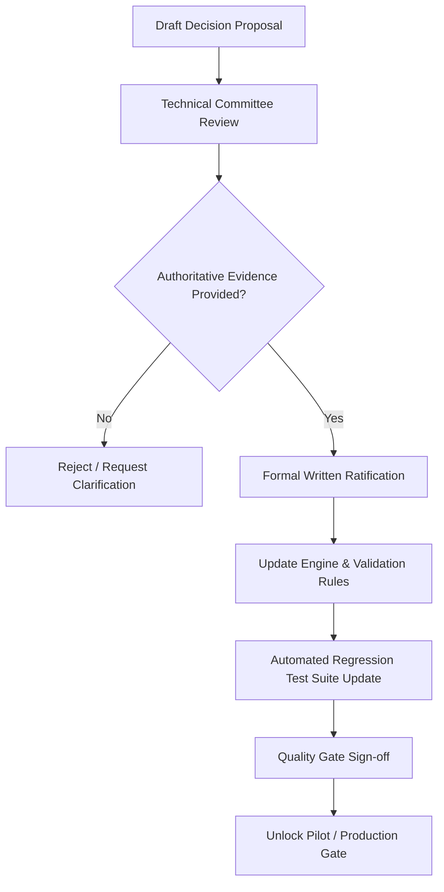

# Measurement Policy Decision Register

**Project:** Bicycle Calibration & Course Measurement Application MVP  
**Baseline Checkpoint:** `prototype-v2.0-provisional-hardened`  
**Date:** October 28, 2026  
**Document Classification:** Formal Policy & Decision Register  

---

## 1. Purpose and Policy Framework

The Bicycle Calibration & Course Measurement Application MVP is designed to calculate bicycle wheel calibration constants (counts/km) using a Jones Counter and compute certified road race course distances.

While the mathematical calculations and local-first persistence mechanisms have been implemented and independently verified, the application **cannot be certified for official road race course measurement** without formal ratification of governing measurement standards.

This document serves as the authoritative register of open policy decisions, citing current implementation status, required evidence, authorized decision-makers, calculation impact, and blocking classifications.

### Governing Policy Principles
1. **Zero Assumption of Authority:** No calculation rule, tolerance, or rounding policy shall be inferred or hardcoded without explicit written specification from the accredited governing body.
2. **Provisional Transparency:** All calculations, displays, and reports remain explicitly labeled `PROVISIONAL` until governing rules are ratified.
3. **Programmatic Finalization Safeguard:** Official finalization and certification locking are programmatically blocked via `policyApproval` in `src/utils/sessionRules.ts`.

---

## 2. Measurement Policy Decision Register

| ID | Policy Item | Current MVP Status | Authoritative Evidence Required | Authorized Decision-Maker | Mathematical / Workflow Impact | Release Blocking Classification |
| :--- | :--- | :--- | :--- | :--- | :--- | :--- |
| **MP-01** | **Governing Measurement Standard & Version** | Hardcoded mock version `ws-0.3` ("Working specification v0.3 — pending approval"). Generates warning in UI. | Formally approved standard manual (e.g., World Athletics Book of Rules TR 57, AIMS Course Measurement Manual, or USATF RRTC Measurement Handbook), including edition, publication date, and binding clauses. | Governing Body Technical Committee / Course Measurement Administrator | Dictates legality of all subsequent calculation rules, report headers, and official certification attribution. | **Controlled Pilot Blocker** **Production Blocker** |
| **MP-02** | **Calibration Course Length & Standard Bounds** | Defaults to `1000m` in setup; accepts any positive float (`> 0`). Warning states `200m–500m under discussion`. | Specified minimum and maximum length bounds for reference courses (e.g., WA/AIMS mandates minimum 300m or 400m; steel taping tension/temperature specifications). | World Athletics / AIMS Technical Delegate or National Federation Rules Committee | Enforces hard upper/lower boundary validation on reference course length inputs in `SessionSetup.tsx`. | **Controlled Pilot Blocker** **Production Blocker** |
| **MP-03** | **Working Constant Selection Rule** | Offers `larger`, `average`, and `notConfigured`. Dynamically applies selection to course distance via `resolveApplicableConstant()`. | Formal standard clause dictating whether the pre-cal, post-cal, larger, average, or smaller constant governs race distance. (Note: WA/AIMS standard practice typically utilizes the *larger* constant of pre/post to prevent short courses, but this requires official written ratification). | Course Measurement Director / Technical Delegate | Selects authoritative divisor $WC_{applicable}$ for calculating distance $D = T / WC$. Eliminates mock/provisional status. | **Controlled Pilot Blocker** **Production Blocker** |
| **MP-04** | **Ride-Consistency Spread Tolerance** | Computes range spread ($\max - \min$ counts) across 4 calibration rides; generates descriptive warning if spread $> 0$. | Numerical tolerance threshold (e.g., maximum allowable count spread or percentage variation, such as $0.08\%$ of average count across 4 rides) and required remediation (e.g., mandatory 5th ride or complete recalibration). | Technical Measurement Advisor / Chief Course Measurer | Promotes ride consistency from an informational warning to an interactive validation blocker or re-ride prompt. | **Controlled Pilot Advisory** **Production Blocker** |
| **MP-05** | **Pre/Post Calibration Difference Tolerance** | Computes absolute difference and percentage change ($Post - Pre$); marked "descriptive only". | Maximum allowable drift percentage between pre-calibration and post-calibration constants (e.g., $0.2\%$ or $0.4\%$, reflecting tyre temperature and pressure variations) before calibration validity is voided. | Governing Body Technical Committee | Introduces formal validation check blocking course distance certification if diurnal drift exceeds standard threshold. | **Controlled Pilot Advisory** **Production Blocker** |
| **MP-06** | **Counter Rollover & Wrapping Policy** | Dropdown allows `notConfigured`, `none`, and `wrap` with configurable `rolloverMax` (e.g., 99,999 or 999,999). | Official policy on allowable Jones Counter hardware models (Model JR, Model OBL, 5-digit vs 6-digit) and whether automatic mathematical wrapping ($finish + (max + 1) - start$) is approved or requires manual physical inspection notes. | Equipment Technical Committee / Technical Delegate | Restricts rollover mode options and establishes valid hardware configuration profiles. | **Controlled Pilot Advisory** **Production Blocker** |
| **MP-07** | **Precision, Rounding, and Reporting Conventions** | Course distance uses full IEEE 754 precision internally; displayed at 3 decimal places. Constant formatted to 4 decimals. | Exact rounding rules specified by standard: whether $WC$ is rounded before division, whether intermediate ride averages are truncated, and whether final race distances are rounded down or ceiling-adjusted (e.g., Short Course Prevention Factor $1.001$). | Governing Body Technical Director / Rules Committee | Formats exact truncation/rounding logic in `src/utils/calibration.ts` and standardizes certificate export format. | **Controlled Pilot Blocker** **Production Blocker** |
| **MP-08** | **Operator Identification & Sign-off Governance** | Mock string `J. Okafor`. Review steps marked by individual checkboxes without digital signature or authentication. | Formal identification requirements: Measurer accreditation ID / grade (e.g., World Athletics Grade A/B/C Measurer), co-measurer / witness attestation requirements, and physical vs electronic signature validity. | Registrar / Legal & Compliance Officer | Replaces mock operator string with authenticated credential verification and tamper-evident sign-off. | **Production Blocker** |
| **MP-09** | **Revision Governance & Record Reopening** | "Start formal revision" button is disabled in UI. Finalization locks session in local IndexedDB. | Governing protocol for handling measurement revisions, errata, re-measurements, and superseding previous calibration certificates while preserving immutable historical records. | Certification Authority / Governing Body Registrar | Requires implementation of formal versioned record branching, superseding certificate generation, and audit preservation. | **Production Blocker** |

---

## 3. Decision Item Detailed Specifications

### MP-01: Governing Measurement Standard & Version
- **Problem Statement:** The prototype currently references an arbitrary placeholder specification (`ws-0.3`). Without an accredited standard reference, measurements generated by the system have no legal or competitive standing.
- **Decision Required:** Confirmation of the exact governing authority and standard document to be hardcoded or configurable in the engine.
- **Candidate Standards:**
  1. *World Athletics & AIMS:* The Measurement of Road Race Courses (Current Edition).
  2. *USATF RRTC:* Procedures for the Measurement and Certification of Road Race Courses.
  3. *Athletics Canada / National Governing Bodies:* Equivalent national adaptations.
- **Pilot Gate Criteria:** For a controlled pilot, a specific documented pilot specification (e.g., "World Athletics 2024 Measurement Guidelines - Provisional Pilot Edition") must be selected and cited in all session headers.

### MP-02: Calibration Course Length & Standard Bounds
- **Problem Statement:** The application accepts any number greater than zero as reference course length. A user can input `1m` or `100,000m` without boundary enforcement.
- **Standard Practice:** Typical international guidelines recommend a calibration course between 300 metres and 1000 metres (ideally 400m to 1000m) laid out on flat, paved asphalt or concrete, measured with a calibrated steel tape with spring balance tension and temperature correction.
- **Decision Required:** Confirm hard minimum bound ($L_{min}$) and maximum bound ($L_{max}$) to be enforced in input validation.
- **Pilot Gate Criteria:** Enforce validation rejecting course lengths outside $200\text{m} \le L \le 2000\text{m}$.

### MP-03: Working Constant Selection Rule (DEF-02 Resolution Context)
- **Problem Statement:** In Phase 2, `resolveApplicableConstant()` was implemented to support `larger`, `average`, or provisional pre-calibration values. However, selecting which rule is official cannot be done by software developers.
- **Engineering Evidence:**
  - `larger`: Divides course counter count by the larger constant, resulting in a conservative (shorter) calculated distance, ensuring that a laid-out course will not be short. This aligns with the World Athletics Short Course Prevention principle.
  - `average`: Takes the arithmetic mean of pre- and post-calibration constants.
- **Decision Required:** Written ratification of whether `larger` is the sole mandatory rule, or whether `average` is permissible under specific temperature-controlled conditions.
- **Pilot Gate Criteria:** Maintain selection dropdown, but lock pilot sessions to the rule mandated by the pilot sponsor, explicitly flagging unapproved selections.

### MP-04 & MP-05: Consistency & Discrepancy Tolerances
- **Problem Statement:** Operators need clear criteria for when calibration rides are invalid. Currently, the UI shows a warning but allows the user to proceed.
- **Decision Required:**
  1. Maximum allowable difference among 4 calibration rides (e.g., spread $\le 0.08\%$ or $\le 4$ counts on 400m).
  2. Maximum allowable difference between pre- and post-calibration working constants (e.g., $\Delta \le 0.4\%$).
  3. Standard protocol when tolerances are exceeded (reject session vs require additional ride vs mandatory re-calibration).
- **Pilot Gate Criteria:** Display explicit threshold values alongside observed spread and delta in comparison cards.

### MP-06: Jones Counter Hardware & Rollover
- **Problem Statement:** Counter rollover logic currently handles generic modulus arithmetic. Real Jones Counters have specific mechanical gear ratios and digit capacities.
- **Decision Required:** Confirm supported hardware models:
  - Jones Counter Model JR (5-digit, rolls over at 99,999)
  - Jones Counter Model OBL (6-digit, rolls over at 999,999)
  - Standard gearing ratio: 23:10 (or ~3.7 counter counts per front wheel revolution).
- **Pilot Gate Criteria:** Provide hardware preset selector (Jones JR 5-digit, Jones OBL 6-digit) pre-populating `rolloverMax`.

### MP-07: Precision, Rounding, and Reporting Conventions
- **Problem Statement:** Full precision float division is used internally. Displayed values are formatted to 3 decimal places for distance and 4 for constants. Official measurement certificates may require specific rounding steps.
- **Decision Required:** Ratify standard certificate formatting:
  - Working Constant: full precision vs rounded to 4 decimals.
  - Intermediate count average: integer rounding vs float.
  - Course distance: rounded down (truncate) vs standard half-up.
- **Pilot Gate Criteria:** Document full mathematical precision formula in report preview alongside displayed values.

### MP-08 & MP-09: Operator Authentication, Sign-off & Revision Governance
- **Problem Statement:** Current system relies entirely on client-side state without operator credentials, digital signatures, or revision history.
- **Decision Required:**
  - Accreditation verification requirements for operators.
  - Digital signature and cryptographic certificate generation requirements.
  - Rules for issuing official certificate addenda or formal revisions.
- **Production Gate Criteria:** Mandate authenticated user login, server-side cryptographic signing of finalized records, and revision branching.

---

## 4. Change Management & Ratification Workflow

No rule shall be enabled in the application's production mode without completing this formal ratification workflow.
