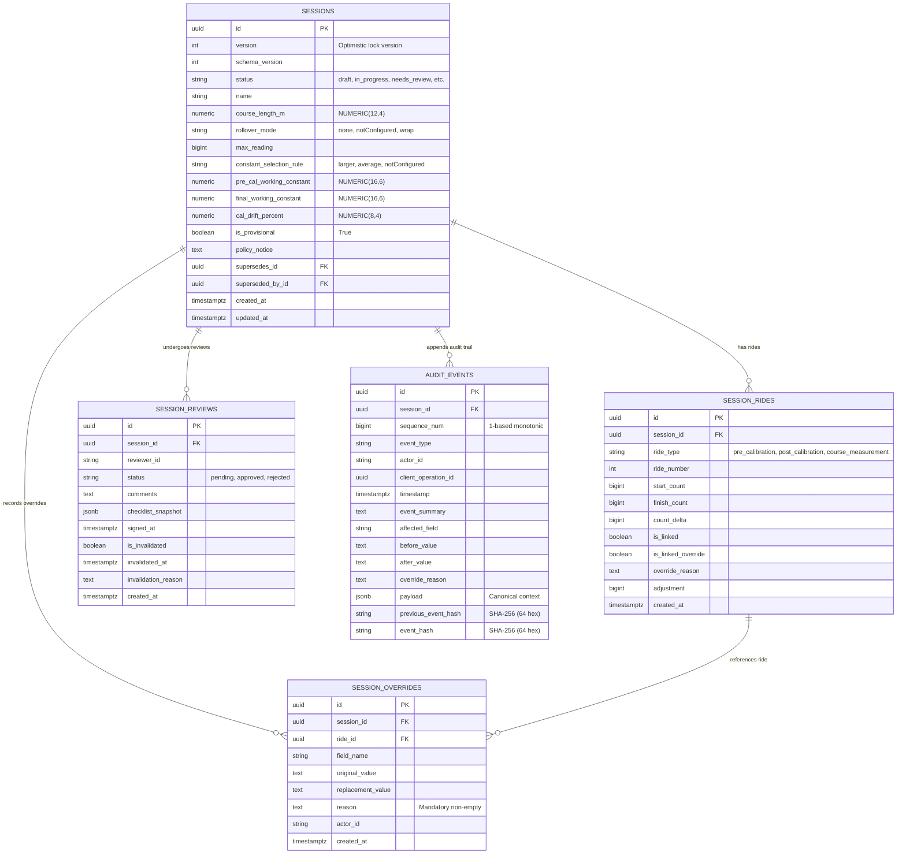

# Phase 10.2 — PostgreSQL Persistence and Append-Only Audit Ledger Implementation Report

**Date:** 2026-11-07  
**Role:** Senior Backend Architect and Implementation Engineer  
**Project:** Bicycle Calibration Calculation / Road Course Measurement Application  
**Repository Working Path:** `/media/sda3/Projects/Calibration`  
**Working Branch:** `feature/phase-6-controlled-pilot`  
**Starting Commit:** `9f4f43f (HEAD -> feature/phase-6-controlled-pilot, origin/feature/phase-6-controlled-pilot) feat(phases-6-10.1.1): complete controlled pilot verification, production architecture, and authoritative calculation backend`  
**Target Milestone:** Phase 10.2 — PostgreSQL Persistence and Append-Only Audit Ledger  
**Prerequisites:** Phase 10.1 Core Backend Foundation & Phase 10.1.1 Defect Remediation  
**Subsequent Phase:** Phase 10.3 Authentication, Identity, and RBAC Enforcement (Pending Project Owner Authorization)  

---

## Executive Summary

Phase 10.2 has been implemented and verified. This milestone introduces durable relational database persistence using **SQLAlchemy 2.0** and **PostgreSQL 16**, deterministic database schema migrations via **Alembic**, and a transactionally coupled, cryptographically chained **append-only audit ledger** implementing Architecture Decision Record **ADR-10-03**.

All functionality was implemented without altering the pure mathematical calculation engine, without approving unratified measurement policies (MP-01 through MP-09), without modifying browser-side IndexedDB records, and without prematurely fabricating authenticated user identities ahead of Phase 10.3 OIDC/RBAC.

### Key Quantitative Achievements
- **Backend Test Suite Expanded:** From 54 to **79 passing tests** (100% pass rate, 0 failures, 0 warnings).
- **New Test Coverage:** 25 new tests spanning schema constraints, exact Decimal round-trips, transaction atomicity and rollback, optimistic concurrency control, audit hash chain verification, tamper detection, API contracts, and Alembic live migration lifecycle.
- **Frontend Regression Protection:** 100% pass rate across TypeScript compilation (`0 errors`), ESLint (`0 errors, 22 pre-existing warnings`), Vitest (`131 / 131 tests passed`), Vite production build (`0 errors`), and Playwright E2E (`14 / 14 tests passed`).
- **Cryptographic Chaining:** Bit-for-bit deterministic SHA-256 hash chaining using RFC 8785 canonical JSON formatting and sequence validation detecting missing events, modified payloads, broken links, and duplicate identifiers.
- **Append-Only Immutability:** Dual defense layer combining application-level SQLAlchemy event listeners (blocking `UPDATE` and `DELETE` on `audit_events`) and SQL permission hardening scripts (`REVOKE UPDATE, DELETE, TRUNCATE`).

---

## 1. Repository Baseline & Environment Safety

### 1.1 Git Working-Tree Baseline
- **Branch:** `feature/phase-6-controlled-pilot`
- **Starting HEAD Commit:** `9f4f43f`
- **Initial Working-Tree Status:** Clean (`nothing to commit, working tree clean`)
- **Safety Enforcement:** No commits, git tags, branch switching, or remote pushes were executed during this milestone. All untracked and modified files were preserved.

### 1.2 Host Environment & Port Allocation
- **Host System:** Linux 6.12 (Parrot OS x86_64).
- **Host Services:** A host PostgreSQL 17 cluster was active on standard port `5432`.
- **Isolation Decision:** To guarantee complete isolation and prevent accidental corruption of existing host databases, the Phase 10.2 development database container was configured via Docker Compose to bind strictly to loopback on dedicated port **`127.0.0.1:5433`** (`5433:5432`).
- **Container Engine:** Podman 5.4.2 / Docker Compose 2.26.1 using official `postgres:16-alpine`.

---

## 2. Architecture & Schema Decisions

### 2.1 Domain Model Separation
The persistence layer strictly separates **source readings** from **derived calculation metrics**:
1. **Source of Truth:** Discrete integer counter readings (`start_count`, `finish_count`), course lengths (`course_length_m`), and explicit configuration parameters (`rollover_mode`, `max_reading`, `constant_selection_rule`).
2. **Authoritative Calculation Boundary:** Derived metrics (`pre_cal_working_constant`, `final_working_constant`, `cal_drift_percent`, `counts_per_km`) are computed exclusively by the pure Python calculation engine (`app.services.calculation_engine`) upon creation or update. Client-submitted derived values are never trusted.
3. **Provisional Attribution:** Until Phase 10.3 introduces federated OpenID Connect (OIDC), actor fields (`measurer_id`, `supervisor_id`, `reviewer_id`, `actor_id`) record provisional identifiers (e.g. `provisional:measurer-1`) without pretending authenticated verification has occurred.

### 2.2 Database Models & Entity-Relationship Structure
The schema is normalized across five core relational tables:



---

## 3. Files Created and Modified

| File Path | Role & Rationale |
| :--- | :--- |
| `docker-compose.yml` | **Created.** Defines development PostgreSQL 16 container, loopback-bound on port 5433 with health checks and persistent volume. |
| `.env.example` | **Created.** Template for environment variables (`DATABASE_URL`, `TEST_DATABASE_URL`, `POSTGRES_PORT`) with safe development placeholders. |
| `backend/pyproject.toml` | **Modified.** Added dependencies `sqlalchemy>=2.0.0`, `alembic>=1.13.0`, and `psycopg[binary]>=3.1.0`. Filtered Starlette testclient deprecation warning. |
| `backend/app/core/config.py` | **Created.** Application configuration reading environment variables with safe database URL masking for logs. |
| `backend/app/core/database.py` | **Created.** SQLAlchemy 2.0 engine, connection pool configuration, and request-scoped session dependency `get_db`. |
| `backend/app/models/base.py` | **Created.** SQLAlchemy 2.0 `DeclarativeBase`. |
| `backend/app/models/session.py` | **Created.** `MeasurementSession` model with lifecycle state, configuration, derived calculation fields, and check constraints. |
| `backend/app/models/ride.py` | **Created.** `SessionRide` model with discrete `BIGINT` readings, override flags, and non-negative count constraints. |
| `backend/app/models/override.py` | **Created.** `SessionOverride` model recording original/replacement values and enforcing non-empty justification reasons. |
| `backend/app/models/review.py` | **Created.** `SessionReview` model with checklist snapshots, signature timestamps, and upstream invalidation tracking. |
| `backend/app/models/audit.py` | **Created.** `AuditEvent` model with hash chain columns, sequence constraints, and event listeners blocking `UPDATE` and `DELETE`. |
| `backend/app/models/__init__.py` | **Created.** Package export discovery for Alembic metadata. |
| `backend/app/audit/canonical.py` | **Created.** Deterministic RFC 8785 canonical JSON serializer and `compute_audit_event_hash` binding previous hash, IDs, timestamps, and payload. |
| `backend/app/audit/ledger.py` | **Created.** Transactional `append_audit_event` service helper using `with_for_update()` for monotonic sequence and chaining. |
| `backend/app/audit/verifier.py` | **Created.** `verify_audit_ledger` detecting discontinuous sequences, broken hash links, content tampering, and duplicate event IDs. |
| `backend/app/audit/__init__.py` | **Created.** Audit package exports. |
| `backend/app/schemas/session.py` | **Created.** Pydantic v2 validation schemas for session creation, update, and response serialization. |
| `backend/app/schemas/audit.py` | **Created.** Pydantic v2 schemas for audit event responses and audit verification results. |
| `backend/app/schemas/__init__.py` | **Modified.** Unified export of calculations, session, and audit schemas. |
| `backend/app/services/session_service.py` | **Created.** Transactional orchestration for session creation, atomic updates, recalculations, review invalidation, optimistic concurrency, and audit ledger emission. |
| `backend/app/api/routes/sessions.py` | **Created.** Minimal REST endpoints (`POST /sessions`, `GET /sessions/{id}`, `PUT /sessions/{id}`, `GET /sessions/{id}/audit-trail`, `POST /sessions/{id}/verify-audit`). |
| `backend/app/main.py` | **Modified.** Registered `sessions_router` under `/api/v1` prefix. |
| `backend/alembic.ini` | **Created.** Alembic configuration pointing to `backend/alembic` script location with dynamic environment URL support. |
| `backend/alembic/env.py` | **Created.** Alembic runtime environment configuring offline and online migrations with `Base.metadata`. |
| `backend/alembic/script.py.mako` | **Created.** Alembic migration template. |
| `backend/alembic/versions/0001_initial_persistence_and_audit_ledger.py` | **Created.** Initial migration creating all 5 tables, check constraints, unique constraints, and indexes. |
| `backend/scripts/harden_audit_permissions.sql` | **Created.** PostgreSQL script revoking `UPDATE`, `DELETE`, `TRUNCATE` privileges on `audit_events` from application roles. |
| `backend/tests/conftest.py` | **Created.** Pytest fixtures providing isolated test database sessions against `calibration_test` with deterministic post-test cleanup. |
| `backend/tests/test_persistence_models.py` | **Created.** 7 unit tests verifying models, relationships, check constraints, unique constraints, and Decimal round-trip. |
| `backend/tests/test_transactions.py` | **Created.** 4 integration tests verifying atomic commit, audit insertion failure rollback, session failure rollback, and audit immutability listeners. |
| `backend/tests/test_audit_integrity.py` | **Created.** 7 tests verifying canonical serialization, valid ledger verification, tampered payload detection, missing event detection, broken hash link detection, and duplicate ID detection. |
| `backend/tests/test_concurrency.py` | **Created.** 3 integration tests verifying stale version rejection, HTTP 409 Problem Details responses, and audit chain preservation under competing updates. |
| `backend/tests/test_session_api.py` | **Created.** 3 integration tests verifying session API lifecycle, golden reference calculation parity, review invalidation, and mandatory override reasons. |
| `backend/tests/test_migrations.py` | **Created.** 1 automated test verifying Alembic live downgrade to `base` and upgrade to `head` on live PostgreSQL. |
| `backend/README.md` | **Modified.** Updated with Docker Compose instructions, migration commands, and test documentation. |
| `README.md` | **Modified.** Updated test and verification instructions with backend commands and architecture cross-references. |
| `docs/FEATURE_IMPLEMENTATION_MATRIX.md` | **Modified.** Updated persistence, conflict resolution, calculation backend, and audit checkpointing rows to reflect verified Phase 10.2 implementation. |

---

## 4. Database Models, Constraints & Relationships

### 4.1 MeasurementSession (`sessions`)
- **Primary Key:** `id` (`UUID`).
- **Concurrency & Lineage:** `version` (`INTEGER`, default `1`), `schema_version` (`INTEGER`, default `1`), `supersedes_id` (`UUID FK`), `superseded_by_id` (`UUID FK`).
- **Database Constraints:**
  - `chk_session_course_length_positive`: `CHECK (course_length_m > 0)`.
  - `chk_session_version_positive`: `CHECK (version >= 1)`.

### 4.2 SessionRide (`session_rides`)
- **Primary Key:** `id` (`UUID`).
- **Foreign Key:** `session_id` (`UUID`) $\to$ `sessions.id` (`ON DELETE CASCADE`).
- **Discrete Readings:** `start_count` (`BIGINT`), `finish_count` (`BIGINT`), `count_delta` (`BIGINT`).
- **Database Constraints:**
  - `chk_rides_non_negative_counts`: `CHECK (start_count >= 0 AND finish_count >= 0)`.
  - `chk_ride_override_reason_required`: `CHECK ((is_linked_override = false) OR (is_linked_override = true AND override_reason IS NOT NULL AND length(trim(override_reason)) > 0))`.
  - `uq_session_ride_number`: `UNIQUE (session_id, ride_type, ride_number)`.

### 4.3 SessionOverride (`session_overrides`)
- **Primary Key:** `id` (`UUID`).
- **Foreign Key:** `session_id` (`UUID`) $\to$ `sessions.id` (`ON DELETE CASCADE`), `ride_id` (`UUID`) $\to$ `session_rides.id` (`ON DELETE SET NULL`).
- **Mandatory Justification:** `reason` (`TEXT`).
- **Database Constraint:**
  - `chk_override_reason_not_empty`: `CHECK (length(trim(reason)) > 0)`.

### 4.4 SessionReview (`session_reviews`)
- **Primary Key:** `id` (`UUID`).
- **Foreign Key:** `session_id` (`UUID`) $\to$ `sessions.id` (`ON DELETE CASCADE`).
- **Invalidation Tracking:** `is_invalidated` (`BOOLEAN`, default `false`), `invalidated_at` (`TIMESTAMPTZ`), `invalidation_reason` (`TEXT`).

### 4.5 AuditEvent (`audit_events`)
- **Primary Key:** `id` (`UUID`).
- **Foreign Key:** `session_id` (`UUID`) $\to$ `sessions.id` (`ON DELETE RESTRICT`) — prevents accidental cascade-deletion of audit records.
- **Monotonic Sequence:** `sequence_num` (`BIGINT`, 1-based sequential counter per session).
- **Cryptographic Hash Chain:** `previous_event_hash` (`VARCHAR(64)`), `event_hash` (`VARCHAR(64)`).
- **Database Constraint:**
  - `uq_audit_session_sequence`: `UNIQUE (session_id, sequence_num)`.
  - Index: `ix_audit_events_session_sequence` on `(session_id, sequence_num)`.

---

## 5. Migration Strategy & Actual Results

### 5.1 Alembic Configuration
Alembic is configured via `backend/alembic.ini` and `backend/alembic/env.py`. It dynamically reads `DATABASE_URL` from the environment, defaulting to the development container URL.

### 5.2 Verification of Migration Lifecycle
Migrations were tested programmatically and via CLI on both `calibration_dev` and `calibration_test` databases:

```bash
# 1. Downgrade to base
PYTHONPATH=backend backend/.venv/bin/alembic -c backend/alembic.ini downgrade base
# Output: Running downgrade 0001_initial -> , Initial persistence and append-only audit ledger schema

# 2. Upgrade to head
PYTHONPATH=backend backend/.venv/bin/alembic -c backend/alembic.ini upgrade head
# Output: Running upgrade -> 0001_initial, Initial persistence and append-only audit ledger schema
```

The automated test `tests/test_migrations.py::test_migration_downgrade_and_upgrade_lifecycle` programmatically executes `command.downgrade(cfg, "base")` and `command.upgrade(cfg, "head")` on live PostgreSQL, querying `information_schema.tables` before and after to verify that table creation and teardown are 100% reproducible.

---

## 6. Transaction Boundaries & Rollback Behavior

All mutating operations in `SessionService` are bounded by explicit transactions:
1. **Material Atomic Update Flow:**
   - Transaction begins on the SQLAlchemy session.
   - Session row is locked using `SELECT ... FOR UPDATE` to serialize concurrent requests.
   - Version check: `session.version == update_in.expected_version`.
   - Raw reading updates applied to `session_rides`.
   - Authoritative recalculation performed via `calculate_calibration`.
   - Downstream active reviews marked `is_invalidated=True` if readings or configuration changed.
   - Corresponding `AuditEvent` records appended to `audit_events`.
   - Session version incremented: `session.version += 1`.
   - `db.commit()` commits the atomic unit.
2. **Rollback Guarantee:**
   - If any step fails (e.g. database check constraint violation, audit write error, network timeout), `db.rollback()` is executed immediately in the exception handler.
   - Tested in `test_transactions.py::test_audit_insertion_failure_causes_transaction_rollback`: Simulating an audit write failure confirmed that zero partial session rows or reading updates remain committed.
   - Tested in `test_transactions.py::test_session_update_failure_leaves_no_partial_audit_events`: Simulating a reading constraint failure confirmed that zero orphan audit events are written.

---

## 7. Optimistic Concurrency Control

In alignment with **ADR-10-04** and **ADR-10-05**:
- Mutating requests (`PUT /api/v1/sessions/{id}`) require an `expected_version` integer in the payload.
- If `session.version != update_in.expected_version`, the service raises `ConcurrencyConflictError`.
- The route handler catches this error and returns **`HTTP 409 Conflict`** formatted as an RFC 7807 / RFC 9457 Problem Details object:
  ```json
  {
    "type": "https://httpstatuses.com/409",
    "title": "Conflict",
    "status": 409,
    "detail": "Concurrency conflict on session '...': expected version 1, but current database version is 2. Please reload the session and reconcile changes.",
    "instance": "/api/v1/sessions/..."
  }
  ```
- **Automated Verification:** Verified in `test_concurrency.py::test_stale_session_version_update_rejected` and `test_concurrency.py::test_api_returns_rfc_7807_problem_details_on_concurrency_conflict`.

---

## 8. Audit-Event Canonicalization & Integrity Verification Design

### 8.1 Canonical Event Serialization (RFC 8785)
To prevent hash discrepancies caused by JSON key reordering, floating-point string representation, or timezone variations:
- Dictionary keys are lexicographically sorted.
- Compact separators are enforced: `(',', ':')` without whitespace.
- UTF-8 characters are preserved directly (`ensure_ascii=False`).
- `Decimal` objects are serialized using exact string representation (`"4967.4625"`).
- `UUID` objects are formatted as lowercase hyphenated strings.
- Timestamps are normalized to UTC with ISO-8601 formatting (`YYYY-MM-DDTHH:MM:SS.ffffffZ`).

### 8.2 Cryptographic Hash Computation
The hash is computed using standard SHA-256:
$$\text{event\_hash} = \text{SHA256}(\text{previous\_event\_hash} \mathbin{\Vert} \text{event\_id} \mathbin{\Vert} \text{session\_id} \mathbin{\Vert} \text{timestamp} \mathbin{\Vert} \text{actor\_id} \mathbin{\Vert} \text{event\_type} \mathbin{\Vert} \text{canonical\_payload})$$

For the session genesis event (`sequence_num = 1`), `previous_event_hash` is initialized to the 64-character zero string:
$$\text{GENESIS\_HASH} = \text{"0000000000000000000000000000000000000000000000000000000000000000"}$$

### 8.3 Integrity Verification Engine
`app.audit.verifier.verify_audit_ledger` executes five sequential integrity checks:
1. **Sequence Monotonicity:** Sequences start at 1 and increment with step 1 ($1, 2, 3, \dots$). Any missing number flags suspect deleted events.
2. **Genesis Linkage:** Event 1 previous hash must equal `GENESIS_HASH`.
3. **Chain Linkage:** Event $N$ previous hash must equal Event $N-1$ event hash.
4. **Content Integrity:** Event $N$ stored hash must match recalculated SHA-256 digest of its components.
5. **ID Uniqueness:** Flags any duplicate event UUIDs.

Verified in `backend/tests/test_audit_integrity.py` across 7 dedicated test scenarios.

---

## 9. Decimal Storage & Round-Trip Precision Findings

### 9.1 Avoidance of Floating-Point Columns
All numerical quantities requiring exact arithmetic are mapped to PostgreSQL `NUMERIC` types:
- `course_length_m`: `NUMERIC(12, 4)`
- `temperature_c`: `NUMERIC(5, 2)`
- `pre_cal_working_constant`, `post_cal_working_constant`, `final_working_constant`: `NUMERIC(16, 6)`
- `cal_drift_percent`: `NUMERIC(8, 4)`
- `course_distance_km`: `NUMERIC(16, 8)`
- Counter readings: `BIGINT` (64-bit integer, discrete whole counts).

### 9.2 Exact Round-Trip Verification
Tested in `test_persistence_models.py::test_decimal_numeric_precision_round_trip`:
- Course length: `Decimal("333.3333")` rounds trips through PostgreSQL as exact `Decimal("333.3333")`.
- Working constant: `Decimal("4967.462500")` preserves the full factor $1.001$ calculation without binary float approximation artifacts.
- Python `Decimal` arithmetic context: The calculation engine operates within Python's default `decimal.DefaultContext` (28 decimal places), ensuring exact precision for rational divisions ($3970 / 4 = 992.5$) and standard repeating decimal divisions until explicit boundary formatting.

---

## 10. Automated Test Coverage & Exact Counts

### 10.1 Backend Test Results (Pytest)
**Command:** `PYTHONPATH=backend backend/.venv/bin/pytest backend/tests -v`  
**Result:** **79 passed in 3.75s (100% pass rate, 0 warnings, 0 failures)**

```
============================= test session starts ==============================
platform linux -- Python 3.13.5, pytest-9.2.0, pluggy-1.7.0 -- backend/.venv/bin/python3
rootdir: /media/sda3/Projects/Calibration/backend
configfile: pyproject.toml
collected 79 items

backend/tests/test_audit_integrity.py (7 tests) ...................... [  8%]
backend/tests/test_calibration.py (7 tests) .......................... [ 17%]
backend/tests/test_concurrency.py (3 tests) .......................... [ 21%]
backend/tests/test_course_distance.py (6 tests) ...................... [ 29%]
backend/tests/test_migrations.py (1 test) ............................ [ 30%]
backend/tests/test_persistence_models.py (7 tests) ................... [ 39%]
backend/tests/test_reference_vectors.py (34 tests) ................... [ 82%]
backend/tests/test_session_api.py (3 tests) .......................... [ 86%]
backend/tests/test_transactions.py (4 tests) ......................... [ 91%]
backend/tests/test_validation.py (7 tests) ........................... [100%]
============================== 79 passed in 3.75s ==============================
```

### 10.2 Frontend Quality Gates Results

| Gate | Execution Command | Result | Test Count / Details |
| :--- | :--- | :---: | :--- |
| **Frontend Typecheck** | `npx tsc --noEmit` | **PASSED** | 0 errors |
| **Frontend Lint** | `npm run lint` | **PASSED** | 0 errors, 22 pre-existing warnings |
| **Frontend Unit Tests** | `npm run test -- --run` | **PASSED** | 8 test files, 131 tests passed |
| **Frontend Production Build** | `npm run build` | **PASSED** | Vite bundle built cleanly in 40.93s |
| **Frontend Playwright E2E** | `npm run test:e2e` | **PASSED** | 14 / 14 E2E tests passed in 1.7m |

---

## 11. Limitations & Unresolved Architecture Decisions

1. **DBA Trust Boundary (Local vs. Offsite WORM):**
   - Application-layer immutability listeners and database role restrictions protect against normal application bugs and malicious clients.
   - However, a database superuser (`postgres`) retains physical capability to alter tables and recompute hash chains if no external trust boundary exists.
   - **Mitigation (Milestone 10.6):** Hourly Merkle roots of the audit ledger signed with an external KMS key and published to an immutable WORM S3 bucket are required for complete legal non-repudiation.
2. **Provisional Actor Attribution:**
   - In Phase 10.2, actor fields (`actor_id`, `measurer_id`, `reviewer_id`) record client-asserted strings.
   - True cryptographic identity, JWT token signature verification, and separation-of-duties enforcement (`reviewer_id != measurer_id`) are deferred to **Milestone 10.3**.
3. **Unratified Measurement Policies (MP-01 through MP-09):**
   - Measurement policies governing acceptable calibration course lengths, ride spread tolerances, pre/post variation thresholds, and final constant rules remain unratified by governing athletic authorities.
   - All session responses remain flagged with `"is_provisional": true` and `"policy_notice": "PROVISIONAL — NOT FOR OFFICIAL CERTIFICATION"`. Finalization endpoints remain disabled.
4. **Client-Server Synchronization:**
   - Phase 10.2 implements the backend persistence and concurrency models.
   - Connecting the React client's local IndexedDB operation queue to the FastAPI backend is scheduled for **Milestone 10.4**.

---

## 12. Security Boundaries & Operational Safeguards

- **No Committed Secrets:** Credentials are not stored in git; `.env` is git-ignored and `.env.example` provides safe development placeholders.
- **Loopback Binding:** PostgreSQL container binds strictly to `127.0.0.1:5433` by default, preventing unintended network exposure.
- **SQL Injection Prevention:** All database operations execute through parameterized SQLAlchemy Core/ORM queries.
- **Structured Error Redaction:** Internal database connection strings, SQL statements, and Python tracebacks are masked; API errors return RFC 7807 Problem Details.
- **Backup & Recovery Considerations:**
  - Standard development dumps can be generated using `pg_dump -h 127.0.0.1 -p 5433 -U calibration_user calibration_dev > backup.sql`.
  - For production (Milestone 10.6), write-ahead logging (WAL) archiving with Continuous Point-in-Time Recovery (PITR) to S3 must be configured.

---

## 13. Phase 10.2 Acceptance Status

| Acceptance Criterion | Evaluation |
| :--- | :---: |
| PostgreSQL schema and migrations implemented and tested | **SATISFIED** |
| Session data and raw readings persisted and retrievable | **SATISFIED** |
| Material updates and audit events are atomic with verified rollback | **SATISFIED** |
| Optimistic concurrency prevents silent lost updates (HTTP 409) | **SATISFIED** |
| Audit verification detects tampering, missing events, and broken links | **SATISFIED** |
| Decimal values round-trip without unintended rounding or truncation | **SATISFIED** |
| Golden calculation reference vectors and provisional guardrails preserved | **SATISFIED** |
| Backend (79 tests) and Frontend quality gates pass cleanly | **SATISFIED** |
| Documentation accurately describes implementation and risks | **SATISFIED** |
| No premature OIDC/RBAC or official certification claims introduced | **SATISFIED** |

**Conclusion:** **Phase 10.2 is COMPLETE.**

---

## 14. Recommended Next Milestone

The recommended next milestone is **Milestone 10.3: Authentication, Identity, and RBAC Enforcement**:
- Integration of OpenID Connect (OIDC) / OAuth2 PKCE token verification.
- Centralized FastAPI dependencies enforcing the 5-tier role hierarchy (`measurer`, `reviewer`, `supervisor`, `auditor`, `admin`).
- Separation of duties guard: Backend blocks `reviewer_id == measurer_id` on review approval endpoints.
- Token claims mapping to audit event actor attribution.

