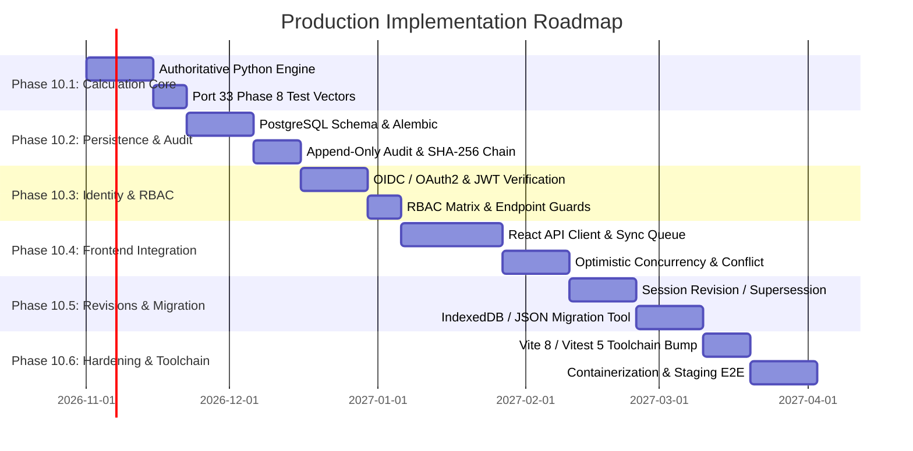

# Phase 10 — Production Implementation Roadmap

**Project:** Bicycle Calibration Calculation / Road Course Measurement Application  
**Repository:** `/media/sda3/Projects/Calibration`  
**Working Branch:** `feature/phase-6-controlled-pilot`  
**Date:** 2026-10-29  
**Status:** Implementation Roadmap (Planning Phase — Implementation Not Started)  

---

## 1. Executive Summary and Phasing Strategy

This roadmap outlines the phased execution strategy to transition the validated Bicycle Calibration Calculation prototype into the production architecture defined in [`docs/PHASE_10_PRODUCTION_ARCHITECTURE.md`](file:///media/sda3/Projects/Calibration/docs/PHASE_10_PRODUCTION_ARCHITECTURE.md).

The strategy follows three strict engineering principles:
1. **Zero Disruption to Existing Prototype:** The working client-side application in `/src` remains fully operational and untampered during early backend milestones.
2. **Provisional Policy Safeguards:** No phase may remove the `policyApproval` blocker or claim official certification readiness until governing policies MP-01 through MP-09 are formally approved by project authorities.
3. **Incremental Test-Driven Verification:** Each milestone establishes automated regression test gates before subsequent milestones commence.

---

## 2. Implementation Milestones Overview



---

## 3. Detailed Milestone Specifications

### Milestone 10.1: Core Backend Foundation & Authoritative Calculation Service

> [!NOTE]
> **Immediate Feasibility:** Milestone 10.1 is the **first implementation milestone that can begin immediately** without waiting for policy ratification or production deployment authorization. It implements an isolated, testable calculation service that encapsulates pure mathematical logic.

- **Objective:** Create the authoritative calculation engine and Pydantic validation schemas in Python (FastAPI).
- **Deliverables:**
  - `backend/app/calculations/engine.py`: Pure Python calculation functions for `CPK`, `WC`, calibration drift, working constant selection (`larger`, `average`, `preCalOnly`), and course measurement length with Short-Course Prevention Factor (SCPF $1.001$).
  - `backend/app/schemas/session.py`: Pydantic v2 schemas for raw counts, ride sequences, and calculation outputs.
  - `backend/tests/test_calculations.py`: Pytest suite ingesting and verifying all **33 Golden Reference Test Cases** established in Phase 8 ([`src/utils/calculationValidation.test.ts`](file:///media/sda3/Projects/Calibration/src/utils/calculationValidation.test.ts)).
- **Acceptance Criteria:**
  - 100% test pass rate across all 33 Phase 8 reference vectors.
  - Arithmetic parity with TypeScript engine within $\pm 0.0000000001$ floating-point delta.
  - Zero database or network dependencies (pure functional engine).

---

### Milestone 10.2: Relational Persistence and Cryptographic Audit Ledger

- **Prerequisite:** Milestone 10.1 complete.
- **Objective:** Implement PostgreSQL schema, SQLAlchemy models, Alembic migrations, and the append-only audit event store.
- **Deliverables:**
  - `backend/app/models/`: SQLAlchemy 2.0 models for `users`, `sessions`, `session_rides`, `session_reviews`, and `audit_events`.
  - `backend/alembic/`: Initial schema migration with unique constraints and non-negative count checks.
  - `backend/app/audit/ledger.py`: Transactionally coupled audit event emitter with SHA-256 hash chaining.
  - Database permission scripts revoking `UPDATE`, `DELETE`, and `TRUNCATE` on `audit_events`.
- **Acceptance Criteria:**
  - Inserting a domain modification without an audit event rolls back the entire transaction.
  - Direct SQL attempts to `UPDATE` or `DELETE` audit events fail with permission denied errors.
  - Hash chain verification script passes over simulated multi-session event logs.

---

### Milestone 10.3: Authentication, Identity, and RBAC Enforcement

- **Prerequisite:** Milestone 10.2 complete; IdP provider selected by project owner.
- **Objective:** Integrate OpenID Connect (OIDC) / OAuth2 authentication and enforce the 5-tier RBAC matrix on all API endpoints.
- **Deliverables:**
  - `backend/app/auth/jwt.py`: RS256 JWT validation, signature verification, and claims decoding.
  - `backend/app/auth/rbac.py`: FastAPI security dependencies enforcing permissions for `measurer`, `reviewer`, `supervisor`, `auditor`, and `admin`.
  - Separation of duties guard: Backend blocks `reviewer_id == measurer_id` on review approval endpoints.
- **Acceptance Criteria:**
  - All protected endpoints reject unauthenticated or expired tokens with `HTTP 401 Unauthorized`.
  - Cross-role privilege escalation attempts return `HTTP 403 Forbidden`.
  - Measurer attempting to sign off on their own review returns `HTTP 403 Forbidden`.

---

### Milestone 10.4: Frontend API Integration & Offline Synchronization Engine

- **Prerequisite:** Milestones 10.1–10.3 complete.
- **Objective:** Connect the React frontend to the FastAPI backend, implementing an offline operation queue and optimistic concurrency synchronization.
- **Deliverables:**
  - `src/services/apiClient.ts`: Authenticated HTTP client handling token injection, automatic refresh, and correlation IDs.
  - `src/services/syncManager.ts`: Local operation queue (`op_id`) storing pending edits in IndexedDB and syncing when online.
  - `src/components/shell/SyncStatusBanner.tsx`: Visual indicator of online/offline status, pending changes count, and last sync timestamp.
  - Integration of `ImportConflictDialog.tsx` to handle `HTTP 409 Conflict` responses without silent overwrites.
- **Acceptance Criteria:**
  - Operator can record complete measurement rides while offline.
  - Online sync reconciles queued changes cleanly using `version_id`.
  - Concurrent edits on two devices trigger the conflict resolution dialog; silent overwrites are impossible.
  - Finalization button is disabled with clear explanation while offline.

---

### Milestone 10.5: Finalization State Machine, Revisions, and Data Migration

- **Prerequisite:** Milestone 10.4 complete.
- **Objective:** Implement server-side finalization locking, superseding revision management, and migration tools for existing IndexedDB / JSON records.
- **Deliverables:**
  - `backend/app/domain/state_machine.py`: Enforces transitions across `draft` $\to$ `in_progress` $\to$ `needs_review` $\to$ `ready_for_final_review` $\to$ `finalized` $\to$ `superseded`.
  - Finalization guard: Enforces zero blockers, completed independent review, supervisor authorization, and policy approval. Returns `HTTP 422` while policies MP-01..09 remain unratified.
  - `backend/app/migration/importer.py`: Migration endpoint accepting v1.0 and v2.0 JSON backups, recalculating all derived values, and generating discrepancy reports.
- **Acceptance Criteria:**
  - Finalized sessions are permanently immutable (all update attempts return `HTTP 422`).
  - Creating a revision creates a linked child session while preserving the immutable parent.
  - Migrating existing Phase 9 JSON test fixtures succeeds in dry-run mode, recalculating metrics accurately and assigning `status='draft'` with provisional labels.

---

### Milestone 10.6: Hardening, Toolchain Upgrade, Containerization & Staging

- **Prerequisite:** Milestones 10.1–10.5 complete.
- **Objective:** Upgrade frontend build dependencies, containerize application components, and conduct staging verification.
- **Deliverables:**
  - Upgrade `vite` to $\ge 6.0$ / `vitest` to $\ge 3.2.6$ (resolving Phase 9 dev advisories).
  - Multi-stage `Dockerfile` and `docker-compose.yml` for FastAPI, PostgreSQL, and static React Nginx bundle.
  - End-to-end Playwright tests executing against the live containerized backend.
  - Automated weekly backup and restore testing CI job.
- **Acceptance Criteria:**
  - Zero vulnerabilities reported by `npm audit` and `pip-audit`.
  - 100% pass rate on backend pytest suite and frontend Playwright suite against live API.
  - Production container image size $< 250\text{ MB}$ with non-root execution.

---

## 4. Testing and Quality-Gate Strategy

Each implementation milestone must pass four mandatory gates before merging:

```
┌─────────────────┐     ┌─────────────────┐     ┌─────────────────┐     ┌─────────────────┐
│     GATE 1      │     │     GATE 2      │     │     GATE 3      │     │     GATE 4      │
│ Type & Linting  │ ──> │ Unit & Parity   │ ──> │ Security Audit  │ ──> │ End-to-End E2E  │
│ tsc + mypy +    │     │ 33 Phase 8      │     │ pip-audit +     │     │ Playwright      │
│ ruff + eslint   │     │ Test Vectors    │     │ npm audit       │     │ Live Stack      │
└─────────────────┘     └─────────────────┘     └─────────────────┘     └─────────────────┘
```

---

## 5. Rollback Strategy

1. **Database Rollbacks:** Every Alembic migration must include a fully tested, reversible `downgrade()` script. Migrations are tested on isolated staging clones before production application.
2. **Feature Flags:** The connection between the React client and the backend API will be gated by an environment variable (`VITE_ENABLE_SERVER_SYNC`). If the backend experiences downtime or unexpected failures during pilot phases, the client can be instantly reverted to local-only IndexedDB mode without code deployment.
3. **Data Preservation Guarantee:** In the event of an abortive migration or corrupted sync, local IndexedDB drafts are never cleared until the server returns an explicit, cryptographically acknowledged sync confirmation.

---

## 6. Explicit Release Blockers for Production Deployment

Production deployment (post-pilot) is **strictly blocked** by the following conditions:

1. **Measurement Policy Approval:** Unratified status of MP-01 through MP-09. Production deployment cannot occur until governing authorities formally ratify the calculation ruleset.
2. **Formal Certification Authorization:** Athletic federations (e.g., World Athletics / AIMS / USATF) must review and approve the electronic measurement certificate format.
3. **Third-Party Security Penetration Test:** A professional external security assessment must be completed against the deployed backend, API gateway, and authentication endpoints.
4. **Disaster Recovery Drill:** Successful live demonstration of restoring a simulated corrupted database from offsite S3 WAL archives to zero data loss within 15 minutes.
