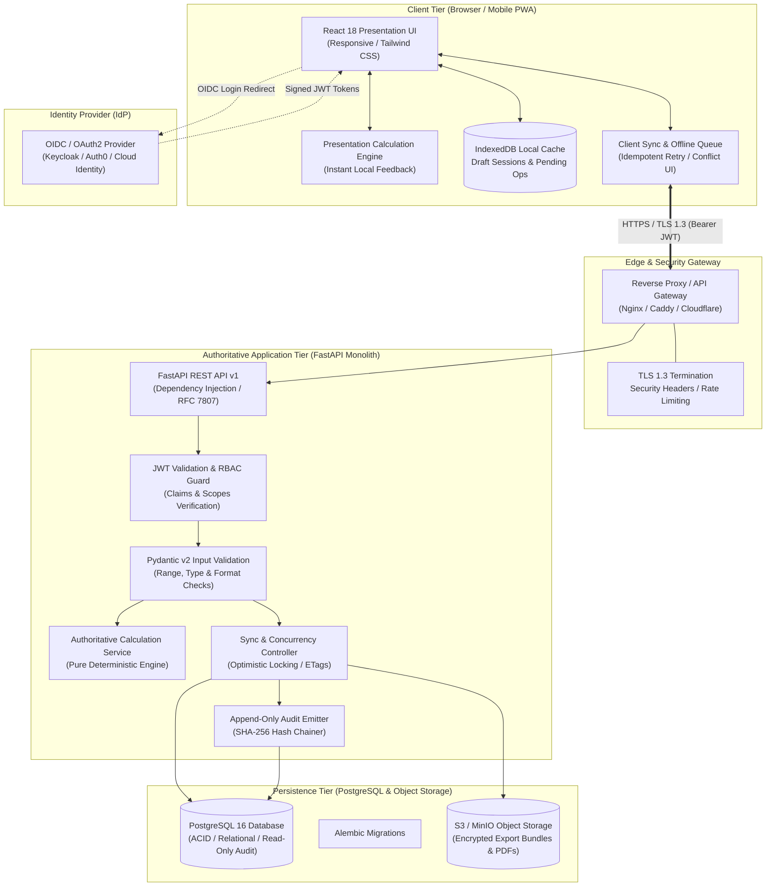
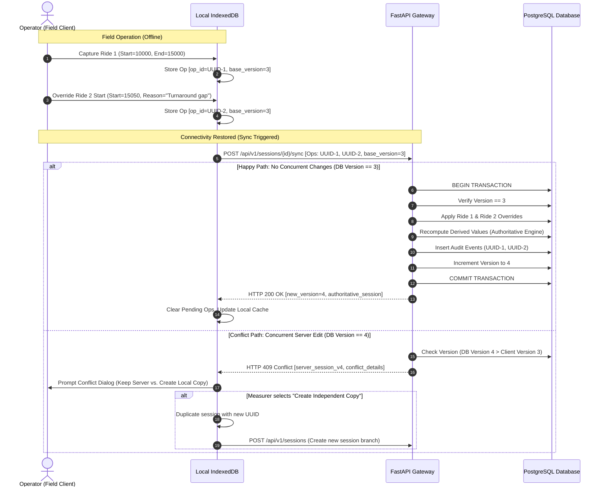
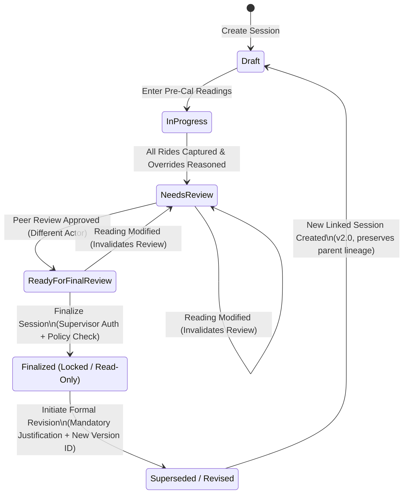

# Phase 10 — Production Architecture and Trust Infrastructure Design

**Project:** Bicycle Calibration Calculation / Road Course Measurement Application  
**Repository:** `/media/sda3/Projects/Calibration`  
**Working Branch:** `feature/phase-6-controlled-pilot`  
**Date:** 2026-10-29  
**Status:** Architecture Proposal & Design Specification (Non-Implemented / Provisional Guardrails Preserved)  
**Governing Measurement Policy Status:** Unratified (MP-01 through MP-09 Unapproved)  

---

## 1. Executive Summary and Scope

The Bicycle Calibration Calculation application has evolved through Phases 1–9 from a single-page prototype into a hardened, verified client-side application featuring local IndexedDB persistence, deterministic arithmetic, structured session exports, and comprehensive provisional safeguards.

However, as documented in [`docs/PHASE_9_SECURITY_RELIABILITY_REPORT.md`](file:///media/sda3/Projects/Calibration/docs/PHASE_9_SECURITY_RELIABILITY_REPORT.md), the client-only Single Page Application (SPA) architecture has inherent security and operational boundaries:
1. **Client Trust Deficit:** In a browser SPA, all memory state, local storage, and execution logic can be inspected and manipulated by an operator using browser developer tools.
2. **Attribution Deficit:** Operator names (`J. Okafor`) and timestamps are self-asserted strings with zero cryptographic authentication or non-repudiation.
3. **Audit Immutability Deficit:** Local IndexedDB records and JSON export files can be modified, truncated, or substituted before submission.
4. **Synchronization Absence:** No mechanism exists for cross-device collaboration, multi-operator reviews, or centralized backup.

This document specifies the **Target Production Architecture** designed to transition the system to an enterprise-grade, trusted measurement platform. It establishes authoritative server-side calculation boundaries, authenticated role-based access control (RBAC), append-only audit event ledgers, optimistic multi-device synchronization, and immutable session revision lineages, while strictly preserving the provisional status of unratified measurement policies.

> [!IMPORTANT]
> **Architecture Status:** This document is an architectural blueprint. The backend services, database migrations, and authentication flows described herein are proposed designs. **No production backend code has been implemented in this phase, and existing client functionality remains intact.**

---

## 2. Baseline Assessment: Current Prototype vs. Production Reality

An architectural comparison between the current verified prototype (Phase 9) and the target production architecture:

| Architectural Dimension | Current Client-Side Prototype (Phase 9) | Target Production Architecture (Phase 10 Design) |
| :--- | :--- | :--- |
| **Execution Tier** | 100% Client-Side (React 18 SPA in browser). | Distributed Client-Server (React SPA + FastAPI Backend). |
| **Calculation Authority** | Browser JavaScript (`src/utils/calibration.ts`). Derived values recalculated in memory and during import. | **Authoritative Server Engine** (Python/Pydantic service). Client calculations are presentation-only drafts. |
| **Data Trust Boundary** | Zero trust boundary: Client inputs, calculations, and local storage share the same runtime context. | Strict trust boundary: Server validates all inputs, computes all derived metrics, and rejects untrusted client metrics. |
| **Identity & Authentication** | Simulated operator strings (`J. Okafor`) stored in component state. | OAuth2 / OpenID Connect (OIDC) with signed JWT access tokens and cryptographically verified operator identities. |
| **Authorization & RBAC** | UI-level visibility controls and client-side programmatic checks in `SessionContext.tsx`. | Server-side role enforcement on every API endpoint (`measurer`, `reviewer`, `supervisor`, `auditor`, `admin`). |
| **Storage & Persistence** | Local browser IndexedDB (`CalibrationMeasurementDB_v2`). Vulnerable to clear-cache or browser reset. | Authoritative PostgreSQL database with ACID transactions, foreign keys, and point-in-time recovery (PITR). |
| **Audit Log Integrity** | In-memory and IndexedDB array of event objects. Vulnerable to local script manipulation. | Append-only database table (`REVOKE UPDATE, DELETE`) with SHA-256 hash chaining and periodic signed checkpoints. |
| **Multi-Device Sync** | Manual JSON export/import via USB/files. Conflict copy resolution on ID collision. | Automated optimistic concurrency sync (`ETag`/versioning), operation log queue, and interactive conflict resolution. |
| **Finalization State** | Local flag (`isFinalized: true`) with locked UI and recalculation locks. Can be unlocked via DevTools. | Server-enforced state machine (`finalized` state immutable in database; changes require a superseding revision). |
| **Policy Enforcement** | Client blocker (`policyApproval`) prevents UI finalization. | Server rejection of finalization requests while governing policies MP-01..09 remain unratified. |

---

## 3. Target Architecture Overview

The target production architecture adopts a **Modular Monolith** pattern. This maximizes operational simplicity, eliminates distributed network failure modes during field measurements, and provides strict transactional guarantees across domain operations and audit writes without requiring distributed microservice orchestration.

### 3.1 Architectural Diagram



---

## 4. Component Responsibilities and Trust Boundaries

### 4.1 Client Tier (Untrusted Presentation Client)
- **Role:** Interactive operator interface for field measurement data collection.
- **Trust Posture:** **Completely untrusted.** The backend treats every HTTP request, header, payload, and query parameter as potentially malicious or manipulated.
- **Responsibilities:**
  - Render responsive measurement grids, calibration forms, audit trails, and validation checklists.
  - Run lightweight presentation calculations in JavaScript to provide instant visual feedback to operators on course.
  - Persist uncommitted drafts and offline operations in local IndexedDB.
  - Manage network connectivity transitions (online $\leftrightarrow$ offline) and queue operations with client-generated UUIDs (`op_id`).
  - Render prominent **PROVISIONAL** banners on all screens, previews, and exports.

### 4.2 Edge / Gateway Tier
- **Role:** Traffic management, network perimeter security, and rate limiting.
- **Responsibilities:**
  - TLS 1.3 termination with strict HSTS, CSP, and CORS policies.
  - Rate limiting per IP and per authenticated user (e.g., 100 req/min for general API, 10 req/min for finalization/export).
  - Request size limits (max 5 MB for session import bundles).
  - Request ID injection (`X-Correlation-ID`) for end-to-end tracing across reverse proxy and backend logs.

### 4.3 Identity Provider (IdP) & Authentication Tier
- **Role:** Authoritative identity verification and credential management.
- **Responsibilities:**
  - Authenticate measurers, reviewers, supervisors, and administrators via OpenID Connect (OIDC) / OAuth2.
  - Support Multi-Factor Authentication (MFA) for privileged operations (review sign-off, session finalization, user administration).
  - Issue cryptographically signed JSON Web Tokens (JWT) containing verified subject IDs (`sub`), names, email addresses, and assigned organization roles (`roles`).

### 4.4 Backend Application Tier (FastAPI Monolith)
- **Role:** Authoritative business logic, calculations, access control, and audit trail emission.
- **Responsibilities:**
  - Validate all inbound payloads against strict Pydantic v2 schemas.
  - Execute **Authoritative Recalculations** using an isolated Python calibration engine. Client-submitted derived fields (`CPK`, `WC`, working constant, course distance) are discarded and recomputed.
  - Enforce atomic transactions: domain record changes and corresponding audit log entries succeed or fail together.
  - Enforce the measurement policy guardrail: finalization attempts return HTTP 422 Unprocessable Entity while MP-01 through MP-09 are unratified.
  - Compute SHA-256 hash chains for audit trail entries.

### 4.5 Data Tier (PostgreSQL 16)
- **Role:** Authoritative relational persistence and immutable event log.
- **Responsibilities:**
  - Store normalized sessions, readings, calibration pairs, reviews, users, and revisions.
  - Enforce foreign keys, check constraints, and unique indexes to prevent data corruption.
  - Store audit events in an append-only table where database-level permissions (`REVOKE UPDATE, DELETE`) prevent modification even by standard application database connections.
  - Facilitate point-in-time recovery (PITR) via write-ahead logging (WAL) archived to secure object storage.

---

## 5. Technology Choices and Justification

| Technology | Selected For | Alternative Considered | Rationale for Selection |
| :--- | :--- | :--- | :--- |
| **FastAPI + Pydantic v2** | Backend Application Framework | Express.js / Django / Go (Gin) | FastAPI provides automated OpenAPI documentation, high-performance async execution, native integration with Pydantic for strict mathematical and schema validation, and Python's superior ecosystem for numerical precision and floating-point verification. |
| **PostgreSQL 16** | Primary Relational Database | MongoDB / MySQL / DynamoDB | Course measurement requires strict relational integrity (sessions link to calibrations, rides link to courses, audit events link to operations). PostgreSQL provides rock-solid ACID transactions, CTEs, window functions for hash verification, and granular SQL permission grants. |
| **SQLAlchemy 2.0 + Alembic** | ORM & Migration Engine | Prisma / Tortoise ORM / Raw SQL | SQLAlchemy 2.0 provides type-safe async relational modeling, robust connection pooling, and explicit transaction boundaries. Alembic provides deterministic, auditable database schema migrations. |
| **OAuth2 / OIDC + JWT** | Authentication Protocol | Custom session cookies / Basic Auth | Industry-standard federated identity allowing decoupling of credential storage from application logic. Enables future integration with governing bodies' federated single sign-on (SSO). |
| **S3-Compatible Object Store (MinIO/S3)** | Artifact & Report Storage | Direct database BYTEA storage / Local filesystem | Keeps relational database lean. Enables immutable object versioning and Write-Once-Read-Many (WORM) retention policies for finalized PDF measurement certificates and raw backup bundles. |

---

## 6. Authoritative Backend Calculation Service

### 6.1 Calculation Boundary Architecture

In the current prototype, calculations are performed client-side in [`src/utils/calibration.ts`](file:///media/sda3/Projects/Calibration/src/utils/calibration.ts). In the production architecture, client calculations are treated strictly as **ephemeral, presentation-only drafts**.

When a session is saved, synchronized, reviewed, or exported, the backend executes the **Authoritative Calculation Service**:

```
                       ┌──────────────────────────────────────────────┐
                       │           INBOUND SESSION PAYLOAD            │
                       │   Raw Counts, Length, Laps, Policy Config    │
                       └──────────────────────┬───────────────────────┘
                                              │
                                              ▼
                       ┌──────────────────────────────────────────────┐
                       │          Pydantic v2 Input Validator         │
                       │   Validates types, non-negativity, ranges    │
                       └──────────────────────┬───────────────────────┘
                                              │
                                              ▼
                       ┌──────────────────────────────────────────────┐
                       │     AUTHORITATIVE CALCULATION ENGINE (PY)    │
                       │   - Computes Pre-Cal Constant (CPK, WC)      │
                       │   - Computes Post-Cal Constant (if present)  │
                       │   - Evaluates Calibration Drift (%)          │
                       │   - Computes Final Working Constant (Rule)   │
                       │   - Computes Measurement Lengths (inc. SCPF) │
                       │   - Evaluates Ride Consistency Delta         │
                       │   - Evaluates Validation Blockers/Warnings   │
                       └──────────────────────┬───────────────────────┘
                                              │
                         ┌────────────────────┴────────────────────┐
                         ▼                                         ▼
         ┌───────────────────────────────┐         ┌───────────────────────────────┐
         │     CALCULATION OUTPUT        │         │      ENGINE METADATA          │
         │ - Derived values stored in DB │         │ - engine_version: "2.1.0"     │
         │ - Returned in API responses   │         │ - ruleset_version: "ws-0.3"   │
         │ - Injected into report models │         │ - calculation_hash: SHA-256   │
         └───────────────────────────────┘         └───────────────────────────────┘
```

### 6.2 Deterministic Parity and Reference Cases
The Python calculation service must mirror the exact mathematical specifications verified in [`docs/PHASE_8_INDEPENDENT_CALCULATION_VALIDATION_REPORT.md`](file:///media/sda3/Projects/Calibration/docs/PHASE_8_INDEPENDENT_CALCULATION_VALIDATION_REPORT.md):
- Standard Calibration Course: $1000\text{ m}$.
- Short-Course Prevention Factor (SCPF): $+0.1\%$ ($1.001$).
- Full floating-point precision maintained across intermediate steps; rounding applied only at designated reporting boundaries.
- **Preservation of Phase 8 Golden Reference Cases:** The backend calculation test suite must ingest and execute the exact same 33 reference vectors used in [`calculationValidation.test.ts`](file:///media/sda3/Projects/Calibration/src/utils/calculationValidation.test.ts) to verify bit-level arithmetic parity between TypeScript and Python engines.

### 6.3 Engine Versioning & Provenance Tracking
Every calculation run stamps the session with:
- `engine_version`: Semantic version of the calculation codebase (e.g., `2.1.0`).
- `ruleset_version`: Identifier of the measurement ruleset applied (e.g., `ws-0.3-provisional`).
- `ruleset_hash`: SHA-256 digest of the rule configuration constants (ensures rule definitions cannot change unnoticed).
- `calculated_at`: Server UTC timestamp of the calculation.

---

## 7. Authentication, Authorization, and RBAC Matrix

### 7.1 Authentication Architecture
Authentication is handled via OAuth2 Authorization Code Flow with PKCE (RFC 7636), supported by an external OpenID Connect (OIDC) provider:
- **Access Tokens:** Short-lived JWTs (15-minute expiration) signed with RS256 / EdDSA, containing user identity (`sub`), email, tenant/organization, and assigned roles.
- **Refresh Tokens:** Long-lived (7-day sliding expiration), stored securely in HTTP-only, SameSite=Strict cookies, rotated on every refresh.
- **Revocation:** Immediate token invalidation via Redis token blocklist or database-backed jti (JWT ID) revocation checks for sensitive operations.

### 7.2 Proposed Role and Permission Matrix

The following five roles are proposed to govern measurement lifecycle integrity:

| Action / Permission | Accredited Measurer | Independent Reviewer | Pilot Supervisor | Read-Only Auditor | System Administrator |
| :--- | :---: | :---: | :---: | :---: | :---: |
| **Create Session Draft** | **ALLOW** | DENY | **ALLOW** | DENY | DENY |
| **Edit Draft Readings & Overrides** | **ALLOW** (Own) | DENY | **ALLOW** (Any) | DENY | DENY |
| **Submit for Review** | **ALLOW** (Own) | DENY | **ALLOW** (Any) | DENY | DENY |
| **Execute Technical Review** | DENY (Self) | **ALLOW** | **ALLOW** | DENY | DENY |
| **Approve / Sign Off Review** | DENY | **ALLOW** | **ALLOW** | DENY | DENY |
| **Finalize Session** | DENY | DENY | **ALLOW** (Conditional) | DENY | DENY |
| **Reopen / Revise Finalized** | DENY | DENY | **ALLOW** (Supervisor) | DENY | **ALLOW** (Joint) |
| **Export Session (JSON/CSV)** | **ALLOW** | **ALLOW** | **ALLOW** | **ALLOW** | **ALLOW** |
| **Import Backup / Migration** | **ALLOW** (Drafts) | DENY | **ALLOW** | DENY | **ALLOW** |
| **View Audit Trail** | **ALLOW** (Own) | **ALLOW** | **ALLOW** | **ALLOW** | **ALLOW** |
| **Manage Users & Roles** | DENY | DENY | DENY | DENY | **ALLOW** |

> [!CAUTION]
> **Separation of Duties:** Under measurement standards, a measurer **cannot independently review their own course measurement**. The API strictly enforces that the user signing off on a review (`reviewer_user_id`) must not match the user who captured the readings (`measurer_user_id`).

---

## 8. Trustworthy Append-Only Audit Model

### 8.1 Limitations of Client-Side Auditing vs. Production Audit Infrastructure

In the current prototype, the audit trail is an array of objects stored in client memory and IndexedDB. An operator with browser DevTools can execute `indexedDB.deleteDatabase()` or manipulate historical records in memory.

The production architecture implements **Cryptographically Verifiable Append-Only Auditing**:
1. **Transactional Coupling:** Every state modification (e.g., updating a start count, overriding a linked reading, signing a review) writes the domain update and the corresponding `audit_events` record within the **exact same database transaction**. If the audit write fails, the domain write rolls back.
2. **Database-Level Protection:** The application's database user has `INSERT` and `SELECT` privileges on the `audit_events` table. `UPDATE`, `DELETE`, and `TRUNCATE` privileges are revoked at the PostgreSQL engine level:
   ```sql
   REVOKE UPDATE, DELETE, TRUNCATE ON TABLE audit_events FROM app_user;
   ```
3. **SHA-256 Hash Chaining:** Each audit event includes a `previous_event_hash`. The event's own `event_hash` is computed as:
   $$\text{event\_hash} = \text{SHA256}(\text{previous\_event\_hash} \mathbin{\Vert} \text{event\_id} \mathbin{\Vert} \text{session\_id} \mathbin{\Vert} \text{timestamp} \mathbin{\Vert} \text{actor\_id} \mathbin{\Vert} \text{event\_type} \mathbin{\Vert} \text{payload\_json})$$
   Any retroactive alteration of an earlier event immediately invalidates the cryptographic hash chain for all subsequent events.
4. **Periodic Signed Checkpoints:** Every hour, a background service computes a Merkle root of all newly created audit events, signs the root with an asymmetric private key held in a Hardware Security Module (HSM) or AWS KMS, and publishes the checkpoint to an immutable WORM S3 bucket.
5. **Realistic Trust Boundary (The DBA Caveat):** 
   - A database administrator with superuser access (`postgres`) could theoretically rewrite tables and recalculate hash chains.
   - **Mitigation:** The external HSM-signed checkpoints published to offsite immutable storage ensure that any database tampering by a rogue DBA would create an irreconcilable discrepancy with the offsite checkpoint ledger.

---

## 9. Synchronization and Offline-First Architecture

### 9.1 Offline Field Reality
Road course calibration occurs outdoors on remote roadways, often in cellular dead zones. The application must operate seamlessly offline without degrading data integrity or allowing duplicate conflicting records.

### 9.2 Optimistic Concurrency and Conflict Resolution Flow



### 9.3 Synchronization Safeguards
1. **Idempotency Keys:** Every client operation sends a unique `X-Operation-ID` (UUIDv4). The server caches operation IDs for 24 hours. Retried network requests return the original result without duplicate audit log creation.
2. **Optimistic Locking via `version_id`:** Every session update requires `If-Match: "{version_id}"`. If another user or device modified the session in the interim, the server returns `HTTP 409 Conflict`.
3. **No Silent Overwrites:** Merging is never performed automatically. If changes conflict, the operator is presented with an interactive visual diff matching the pattern established in [`src/components/shell/ImportConflictDialog.tsx`](file:///media/sda3/Projects/Calibration/src/components/shell/ImportConflictDialog.tsx).
4. **Offline Finalization Prohibited:** Finalization requires real-time cryptographic authentication, peer review verification, and authoritative server recalculation. **An offline client cannot finalize a session.**

---

## 10. Session Lifecycle, Finalization, and Revision State Machine

### 10.1 Lifecycle State Machine



### 10.2 State Transition Requirements

| State | Allowed Transitions | Transition Prerequisites & Guards |
| :--- | :--- | :--- |
| **Draft** | $\to$ `InProgress` | Name, date, course definition, and temperature recorded. |
| **InProgress** | $\to$ `NeedsReview` | Minimum required rides completed; all linked overrides have mandatory reason strings ($\ge 10$ characters). |
| **NeedsReview** | $\to$ `ReadyForFinalReview` | Independent reviewer conducts technical audit, signs off with credentials. |
| **ReadyForFinalReview** | $\to$ `Finalized` | **Strict Transition Guard:**<br>1. Blockers count == 0.<br>2. Independent review signature valid.<br>3. **Governing Policy Approval:** If MP-01..09 unapproved, server rejects with HTTP 422.<br>4. Pilot Supervisor credentials verified.<br>5. Atomic transaction locks session record. |
| **Finalized** | $\to$ `Superseded` | Record is permanently read-only. Modification is physically blocked. Corrections require creating a **Revision Child Session** (`v1.1` or `v2.0`) with explicit supersession lineage and reason. |

---

## 11. Relational Database Schema Design (PostgreSQL)

```sql
-- Core Enumerations
CREATE TYPE session_status AS ENUM (
    'draft', 'in_progress', 'needs_review', 'ready_for_final_review', 'finalized', 'superseded'
);

CREATE TYPE user_role AS ENUM (
    'measurer', 'reviewer', 'supervisor', 'auditor', 'admin'
);

CREATE TYPE ride_type AS ENUM (
    'pre_calibration', 'post_calibration', 'course_measurement'
);

-- Users and Access Control
CREATE TABLE users (
    id UUID PRIMARY KEY DEFAULT gen_random_uuid(),
    email VARCHAR(255) UNIQUE NOT NULL,
    full_name VARCHAR(255) NOT NULL,
    role user_role NOT NULL DEFAULT 'measurer',
    organization VARCHAR(255),
    is_active BOOLEAN NOT NULL DEFAULT true,
    created_at TIMESTAMPTZ NOT NULL DEFAULT clock_timestamp(),
    updated_at TIMESTAMPTZ NOT NULL DEFAULT clock_timestamp()
);

-- Authoritative Sessions Table
CREATE TABLE sessions (
    id UUID PRIMARY KEY DEFAULT gen_random_uuid(),
    session_version INTEGER NOT NULL DEFAULT 1,
    status session_status NOT NULL DEFAULT 'draft',
    name VARCHAR(255) NOT NULL,
    description TEXT,
    measurer_id UUID NOT NULL REFERENCES users(id),
    supervisor_id UUID REFERENCES users(id),
    
    -- Course & Environmental Parameters
    course_name VARCHAR(255) NOT NULL,
    course_length_m NUMERIC(12, 4) NOT NULL,
    surface_type VARCHAR(50) NOT NULL,
    temperature_c NUMERIC(5, 2) NOT NULL,
    
    -- Policy & Calculation Parameters
    constant_selection_rule VARCHAR(50) NOT NULL DEFAULT 'larger',
    ride_matching_rule VARCHAR(50) NOT NULL DEFAULT 'average',
    working_spec_version VARCHAR(50) NOT NULL DEFAULT 'ws-0.3-provisional',
    policy_approval_status VARCHAR(50) NOT NULL DEFAULT 'unapproved',
    
    -- Authoritative Derived Values (Calculated Server-Side Only)
    pre_cal_working_constant NUMERIC(14, 6),
    post_cal_working_constant NUMERIC(14, 6),
    final_working_constant NUMERIC(14, 6),
    cal_drift_percent NUMERIC(8, 4),
    measured_course_distance_m NUMERIC(12, 4),
    course_length_difference_m NUMERIC(12, 4),
    calculation_engine_version VARCHAR(50) NOT NULL,
    
    -- Finalization & Revision Metadata
    is_finalized BOOLEAN NOT NULL DEFAULT false,
    finalized_at TIMESTAMPTZ,
    finalized_by UUID REFERENCES users(id),
    superseded_by_id UUID REFERENCES sessions(id),
    supersedes_id UUID REFERENCES sessions(id),
    revision_reason TEXT,
    
    created_at TIMESTAMPTZ NOT NULL DEFAULT clock_timestamp(),
    updated_at TIMESTAMPTZ NOT NULL DEFAULT clock_timestamp()
);

-- Readings & Ride Sequences
CREATE TABLE session_rides (
    id UUID PRIMARY KEY DEFAULT gen_random_uuid(),
    session_id UUID NOT NULL REFERENCES sessions(id) ON DELETE CASCADE,
    ride_type ride_type NOT NULL,
    ride_number INTEGER NOT NULL,
    start_count BIGINT NOT NULL,
    end_count BIGINT NOT NULL,
    count_delta BIGINT GENERATED ALWAYS AS (end_count - start_count) STORED,
    is_linked_override BOOLEAN NOT NULL DEFAULT false,
    override_reason TEXT,
    start_time TIMESTAMPTZ,
    end_time TIMESTAMPTZ,
    created_at TIMESTAMPTZ NOT NULL DEFAULT clock_timestamp(),
    CONSTRAINT chk_positive_delta CHECK (end_count >= start_count),
    CONSTRAINT chk_override_reason CHECK (
        (is_linked_override = false) OR (is_linked_override = true AND LENGTH(TRIM(override_reason)) >= 10)
    ),
    UNIQUE (session_id, ride_type, ride_number)
);

-- Peer Review Sign-Offs
CREATE TABLE session_reviews (
    id UUID PRIMARY KEY DEFAULT gen_random_uuid(),
    session_id UUID NOT NULL REFERENCES sessions(id) ON DELETE CASCADE,
    reviewer_id UUID NOT NULL REFERENCES users(id),
    status VARCHAR(50) NOT NULL,
    comments TEXT NOT NULL,
    checklist_snapshot JSONB NOT NULL,
    signed_at TIMESTAMPTZ NOT NULL DEFAULT clock_timestamp(),
    is_invalidated BOOLEAN NOT NULL DEFAULT false,
    invalidated_at TIMESTAMPTZ,
    invalidation_reason TEXT
);

-- Cryptographically Chained Append-Only Audit Trail
CREATE TABLE audit_events (
    event_id UUID PRIMARY KEY DEFAULT gen_random_uuid(),
    session_id UUID NOT NULL REFERENCES sessions(id),
    sequence_num BIGSERIAL NOT NULL,
    event_type VARCHAR(100) NOT NULL,
    actor_id UUID NOT NULL REFERENCES users(id),
    client_operation_id UUID,
    timestamp TIMESTAMPTZ NOT NULL DEFAULT clock_timestamp(),
    previous_event_hash VARCHAR(64) NOT NULL,
    event_hash VARCHAR(64) NOT NULL,
    payload JSONB NOT NULL,
    UNIQUE (session_id, sequence_num)
);

-- Database Permission Hardening
REVOKE UPDATE, DELETE, TRUNCATE ON TABLE audit_events FROM PUBLIC;
GRANT SELECT, INSERT ON TABLE audit_events TO app_user;
```

---

## 12. Data Migration Strategy from Existing Client Storage

### 12.1 Sources to be Migrated
1. **Browser IndexedDB:** Draft and unfinalized sessions currently stored in client browsers under `CalibrationMeasurementDB_v2`.
2. **Versioned JSON Exports:** Files conforming to schema versions `1.0.0` and `2.0.0` generated via `src/utils/sessionExport.ts`.

### 12.2 Migration Pipeline Architecture

```
 ┌──────────────────────┐   ┌──────────────────────┐
 │  Local IndexedDB     │   │  JSON Backup Files   │
 │  (Client Browser)    │   │  (Schema v1.0, v2.0) │
 └──────────┬───────────┘   └──────────┬───────────┘
            │                          │
            └────────────┬─────────────┘
                         │
                         ▼
        ┌───────────────────────────────────┐
        │     MIGRATION INGESTION API       │
        │   POST /api/v1/sessions/migrate   │
        └────────────────┬──────────────────┘
                         │
                         ▼
        ┌───────────────────────────────────┐
        │  Schema Normalizer & Validator    │
        │  - Upgrades v1.0/v2.0 to v3.0     │
        │  - Checks Zod / Pydantic schema   │
        └────────────────┬──────────────────┘
                         │
                         ▼
        ┌───────────────────────────────────┐
        │ Authoritative Server Recalculation│
        │ - Recalculates all derived metrics│
        │ - Emits reconciliation discrepancy│
        │   report if client != server      │
        └────────────────┬──────────────────┘
                         │
                         ▼
        ┌───────────────────────────────────┐
        │   Provenance & Audit Tagging      │
        │ - Injects 'MIGRATED_FROM_V2' audit│
        │ - Attaches original export hash   │
        │ - Sets policy_approval='unapproved'│
        │ - Sets status='draft' (unfinalized│
        └────────────────┬──────────────────┘
                         │
                         ▼
        ┌───────────────────────────────────┐
        │  Atomic Transaction Commit (PG)   │
        │  Stores session, rides, and audit │
        └───────────────────────────────────┘
```

### 12.3 Migration Safeguards
- **Dry-Run Mode:** An API flag `?dry_run=true` validates the file, executes calculations, and returns a detailed comparison report without writing to the database.
- **Strict Provisional Preservation:** All migrated records, regardless of their exported status, are imported with `policy_approval = 'unapproved'` and `status = 'draft'` or `status = 'in_progress'`. A client-generated file can **never** import directly into `finalized` status on the server.
- **Zero Data Loss Guarantee:** If an imported session has missing or incomplete audit trail history, the server imports the domain readings and appends a synthetic `AUDIT_GAP_DETECTED` event documenting that the pre-migration history was incomplete.

---

## 13. Operational Controls, Disaster Recovery, and Observability

### 13.1 Backup and Recovery
- **Continuous Archiving:** PostgreSQL Write-Ahead Logging (WAL) continuously streamed to secure S3 storage, enabling Point-In-Time Recovery (PITR) with an RPO (Recovery Point Objective) $\le 5\text{ minutes}$.
- **Full Daily Snapshots:** Automated daily pg_dump encrypted with AES-256 and stored across two geographically distinct cloud regions.
- **Automated Restore Testing:** Weekly scheduled automated CI/CD jobs spin up an isolated database container, restore the latest backup, and run the calculation verification suite to prove backup integrity.

### 13.2 Monitoring and Incident Response
- **Structured Audit Logging:** All security events (login failures, authorization denials, finalization rejections, hash chain verification failures) emit structured JSON logs ingested into OpenSearch / Datadog.
- **Alerting Thresholds:** Immediate alerts triggered on:
  - Any attempt to update or delete rows in `audit_events`.
  - Consecutive finalization attempts with active blockers.
  - Calculation divergence $> 0.0001\%$ between client preview and server recalculation.
  - JWT signature validation failures $> 5\text{ per minute}$.

---

## 14. Architecture Review Verdict and Next Steps

| Assessment Dimension | Rating | Technical Basis |
| :--- | :---: | :--- |
| **Existing Prototype Integrity** | **PASS** | React SPA (Phase 9) remains fully functional, passing 131/131 Vitest unit tests, 14/14 Playwright E2E tests, and zero type errors. |
| **Production Architecture Completeness** | **PASS** | Modular monolith design fully addresses client trust deficits, authoritative calculations, append-only auditing, offline synchronization, and relational schema. |
| **Measurement Policy Status** | **BLOCKED** | Governing policies MP-01 through MP-09 remain unratified. The architecture strictly enforces provisional blocking on finalization. |
| **Controlled-Pilot Status** | **PASS WITH CONDITIONS** | The existing client-side prototype is authorized for field pilot testing under the physical supervision of [`docs/CONTROLLED_PILOT_PROTOCOL.md`](file:///media/sda3/Projects/Calibration/docs/CONTROLLED_PILOT_PROTOCOL.md). |
| **Production Implementation Readiness** | **BLOCKED** | Implementation requires project-owner approval of ADRs (ADR-10-01 through ADR-10-08) and formal measurement policy ratification. |
