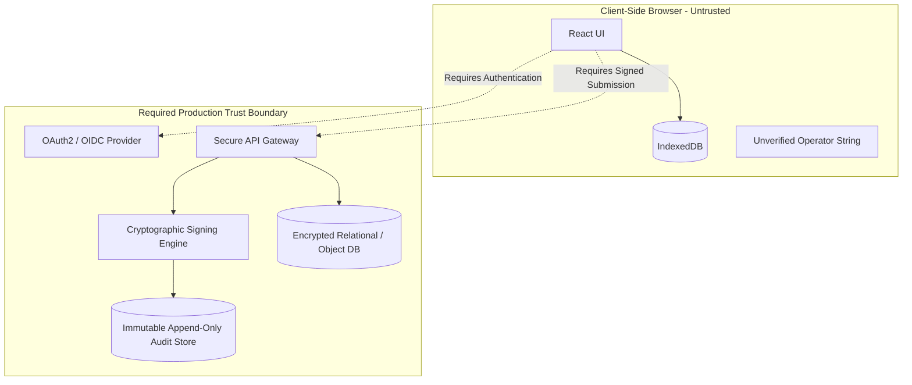
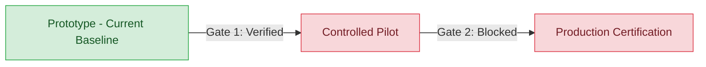

# Phase 4 Release Readiness and Measurement Policy Assessment

**Application:** Bicycle Calibration Calculation MVP  
**Assessment Date:** October 28, 2026  
**Auditor / Reviewer Roles:** Senior Software Architect, QA Engineer, Application Security Reviewer, Technical Product Lead  
**Repository Path:** `/media/sda3/Projects/Calibration`  
**Current Branch:** `main`  
**Baseline Reference Tag:** `prototype-v2.0-provisional-hardened` (`bf9094b`)  
**Base Implementation Commit:** `3ec21cd`  

---

## 1. Executive Summary

This assessment establishes an evidence-based roadmap defining the architectural, security, testing, and policy criteria required for the Bicycle Calibration Calculation application to advance from an internal provisional prototype (`prototype-v2.0-provisional-hardened`) to a controlled pilot, and ultimately to regulated production for official road race course measurement.

### Current System Posture
- **Calculation Correctness (DEF-02):** **Solved and Verified.** Course distance calculation dynamically links to the authoritative working constant via `resolveApplicableConstant()`, properly utilizing provisional pre-calibration values when post-calibration is incomplete or unconfigured, and applying selected final constants (`larger` or `average`) once post-calibration is completed.
- **Local Persistence (DEF-01):** **Solved and Verified.** Native IndexedDB persistence (`src/utils/storage.ts`) guarantees data survival across page reloads and browser restarts with hydration race protection and corrupt record resilience.
- **Policy Enforcement:** **Hardened and Blocked.** Because the governing road-measurement standard has not been formally ratified by an accredited standards authority (e.g., World Athletics / AIMS / USATF), all calculations and reports are programmatically tagged as **`PROVISIONAL`**, and official certification finalization is programmatically blocked (`policyApproval` rule).

### Verified Facts vs. Unverified Assumptions

| Architectural Domain | Verified Facts (Evidence-Based) | Unverified Assumptions (Risk Areas) |
| :--- | :--- | :--- |
| **Mathematical Engine** | 62 automated Vitest tests confirm precision arithmetic, edge cases, rollover modulus, and dynamic basis routing. | The choice between `larger` and `average` as the official governing standard is an unverified operational assumption. |
| **Data Storage** | Native IndexedDB saves and restores full sessions, ride tables, overrides, and audit trails in headless test runs (`fake-indexeddb`). | Long-term browser storage quota eviction, private/incognito mode behavior, and cross-browser IndexedDB quirks remain unverified in automated CI. |
| **Security & Identity** | Client-side application with zero server attack surface in production build; `esbuild` and `tinypool` patched via npm overrides. | Assuming the client-side operator string (`J. Okafor`) provides accountability or that local IndexedDB audit trails are tamper-evident. |
| **User Interface** | Static UI snapshots confirm responsive layout on desktop, tablet, and mobile viewports, and blocked finalization modal. | Assuming complete keyboard accessibility (WCAG 2.1 AA) and touch interaction reliability without automated browser testing. |

---

## 2. Workstream 1: Git Checkpoint & Baseline Integrity

### 2.1 Checkpoint Inspection
- **Annotated Tag:** `prototype-v2.0-provisional-hardened`
- **Tagged Commit SHA:** `bf9094b2e739df610d32651d568f5494e257406f`
- **Tagged Commit Message:** `chore: complete phase 3 verification hardening`
- **Implementation Commit SHA:** `3ec21cd938c34177336e94efa065e9f52cfc92d8` (`feat(remediation): complete Phase 2 and 3 calculation correctness, local persistence, and verification`)
- **Tag Annotation Message:**
  > `Provisional hardened prototype baseline v2.0. Calculation correctness (DEF-02) and local-first IndexedDB persistence (DEF-01) independently verified with 62 automated tests passing. Governing road-measurement standard and production trust infrastructure remain unapproved and unimplemented.`

### 2.2 Ancestry & Difference Analysis
- **Ancestry:** `bf9094b` is a direct child of `3ec21cd`.
- **File Difference (`git diff 3ec21cd..bf9094b`):** Exactly 1 file modified/added: `docs/PHASE_3_BASELINE_CHECKPOINT_REPORT.md` (+101 lines).
- **Code Integrity:** Zero application code, test suites, or configuration files differ between the implementation commit and the tagged commit. The tag cleanly anchors both the verified codebase and its corresponding verification report.
- **Baseline Test Reproducibility:** Executing `npm run test` against the tagged commit reproduces the exact reported baseline: **4 test suites passed (100%), 62 tests passed, 0 failed**.

---

## 3. Workstream 2: Dependency & Security Assessment

### 3.1 Toolchain & Dependency Inventory
- **Vite:** `v5.4.21` (installed via `@vitejs/plugin-react` and root devDependencies).
- **esbuild:** `v0.25.12` (resolved via `overrides` in `package.json`).
- **tinypool:** `v2.2.0` (resolved via `overrides` in `package.json`).
- **Vitest:** `v1.6.1` (development test runner).
- **fake-indexeddb:** `v6.2.6` (headless test utility).

### 3.2 Vulnerability & Advisory Analysis

An audit via `npm audit` reveals 3 reported vulnerability groups against `vite <= 6.4.3`:
1. **GHSA-4w7w-66w2-5vf9 (High):** Path traversal in optimized dependency `.map` file handling.
2. **GHSA-9jrq-w75r-8gcw (Moderate):** Cross-origin script execution via Vite development server custom middleware.
3. **GHSA-rq7h-c2jc-7f22 / launch-editor advisories (High/Critical):** Server-side path handling and arbitrary command execution when invoking configured external editors from the Vite error overlay.

#### Development Server vs. Production Build Exposure
- **Development Server Exposure:**
  - The advisories affect only the Vite development HTTP server (`npm run dev`) and its internal middleware (`launch-editor`, DevTools sourcemap endpoints).
  - **Host Binding Inspection:** In [`vite.config.ts`](file:///media/sda3/Projects/Calibration/vite.config.ts), `server.host` is unspecified. Vite 5 defaults strictly to `localhost` (`127.0.0.1`), meaning the server does **not** bind to `0.0.0.0` or expose ports to the local network unless explicitly run with `--host`.
  - **Developer Machine Risk:** On shared networks, if a developer runs `npm run dev --host`, an attacker on the same subnet could exploit path traversal or middleware vulnerabilities. On Linux/macOS, Windows-specific UNC path injection (`launch-editor`) does not apply, but cross-origin middleware execution remains a valid risk if a developer visits an untrusted website while the local dev server is active.
- **Production Build Exposure:**
  - Running `npm run build` generates purely static HTML, CSS, and minified client-side JavaScript in `dist/`.
  - Vite's development server, `launch-editor`, and development middleware are **not packaged or deployed** into the production bundle.
  - **Source Map Analysis:** In `dist/assets/`, zero `.map` files are generated (`build.sourcemap: false`). Source code is not leaked in the production artifacts.

### 3.3 Security Architecture Deficits for Production Release
The application currently operates entirely in client-side browser memory and IndexedDB. For official course measurement certification, the following production security controls are required:

1. **Authentication & Identity Verification:** Currently, the operator is a plain string (`J. Okafor`). Any user with browser access can claim any identity. Production requires accredited Measurer authentication (OAuth2/OIDC, MFA).
2. **Audit Log Non-Repudiation:** Current audit logs are stored in client-side IndexedDB. A user can alter timestamps, readings, or reasons using Chrome DevTools. Production requires server-side, append-only, cryptographically signed audit logs.
3. **Server-Side Validation:** All calculations performed client-side must be independently recomputed and verified on a trusted backend before issuing official certificates.
4. **Data Durability & Disaster Recovery:** Local IndexedDB is subject to browser cache eviction, device damage, or browser storage clearing. Production requires automatic cloud backup, synchronization, and point-in-time recovery.

---

## 4. Workstream 3: Measurement Policy Blockers

A comprehensive register of open measurement decisions has been codified in [`docs/MEASUREMENT_POLICY_DECISION_REGISTER.md`](file:///media/sda3/Projects/Calibration/docs/MEASUREMENT_POLICY_DECISION_REGISTER.md).

### Summary of Governing Policy Blockers

| Policy ID | Domain | Issue Summary | Pilot Status | Production Status |
| :---: | :--- | :--- | :---: | :---: |
| **MP-01** | Standard Ratification | Governing standard is unratified; mock specification `ws-0.3` is used. | **BLOCKER** | **BLOCKER** |
| **MP-02** | Course Length Bounds | Input accepts any positive float without upper/lower limits. | **BLOCKER** | **BLOCKER** |
| **MP-03** | Final Constant Rule | Choice between `larger` and `average` is unconfirmed by governing authority. | **BLOCKER** | **BLOCKER** |
| **MP-04** | Spread Tolerance | Ride consistency tolerance is unconfirmed; warnings do not block. | Advisory | **BLOCKER** |
| **MP-05** | Pre/Post Drift Tolerance | Allowable variation between pre- and post-calibration is unconfirmed. | Advisory | **BLOCKER** |
| **MP-06** | Hardware Rollover | Jones Counter models (5-digit vs 6-digit) and rollover rules unstandardized. | Advisory | **BLOCKER** |
| **MP-07** | Precision & Rounding | Official rounding rules for working constants and distances unconfirmed. | **BLOCKER** | **BLOCKER** |
| **MP-08** | Operator Sign-Off | Measurer identity and digital signatures unauthenticated. | Provisional OK | **BLOCKER** |
| **MP-09** | Revision Governance | Formal revision and certificate superseding flows unimplemented. | Provisional OK | **BLOCKER** |

**Conclusion:** The application must remain strictly designated as a provisional testing prototype. Official certification finalization must remain programmatically blocked.

---

## 5. Workstream 4: End-to-End Verification Assessment & Browser Gaps

### 5.1 Six-Screen Workflow Assessment Matrix

| Screen / Workflow | Implementation Status | Automated Vitest Coverage | Browser Subagent Observation | Verified End-to-End in Browser? | Gaps & Limitations |
| :--- | :---: | :---: | :---: | :---: | :--- |
| **1. Session List & Setup** | Implemented | 8 storage tests | Rendered in snapshots `session_list_page_*` | **Partially Verified** | Session creation and listing render correctly; multi-device search/filtering unverified by CI. |
| **2. Pre-Calibration** | Implemented | 31 unit tests | Rendered in snapshots `session_stepper_view_*` | **Partially Verified** | Math and auto-linking logic verified in Vitest; DOM typing and override modal interactive submission unverified by CI. |
| **3. Course Distance** | Implemented | 20 defect tests | Rendered in snapshots `course_distance_screen_*` | **Verified** | Dynamic working constant display, full precision, and provisional badges verified in Vitest and browser. |
| **4. Post-Calibration** | Implemented | 31 unit tests | Rendered in snapshots `post_calibration_*` | **Verified** | Post WC computation, side-by-side comparison, and percentage delta verified in Vitest and browser. |
| **5. Final Review** | Implemented | 3 rules tests | Rendered in snapshots `session_003_review_*` | **Verified** | Invalidation of stale reviews, checklist evaluation, and audit trail rendering verified. |
| **6. Report & Finalize** | Implemented | 3 rules tests | Rendered in snapshots `finalize_blocked_dialog_*` | **Verified** | Report preview snapshot verified; finalization blocker on unapproved policy verified visually and in unit tests. |

### 5.2 Test Scenario Verification Register

| Scenario | Tested In Vitest? | Tested In Browser? | Evidence / Artifact | Classification |
| :--- | :---: | :---: | :--- | :---: |
| **1. Create, Save, Refresh, Reopen** | Yes (8 tests in `storage.test.ts`) | Manual / Visual only | Storage tests verify atomic commit and hydration guard; live browser reload unverified in automated CI. | **Partially Verified** |
| **2. Sequential Readings & Overrides** | Yes (`storage.test.ts`) | Visual modal snapshot | Override reason recording verified in tests; modal DOM interaction unverified in automated CI. | **Partially Verified** |
| **3. Upstream Reading Edits & Review Invalidation** | Yes (`calculationDefect.test.ts`) | Visual badge snapshot | Signature hashing and `'stale'` transition verified in unit tests and observed on review page. | **Verified** |
| **4. Constant Rule Changes & Distance Recalculation** | Yes (`calculationDefect.test.ts`) | Visual snapshot | Dynamic recomputation with `larger`, `average`, `pre` verified in 20 Vitest tests and browser view. | **Verified** |
| **5. Incomplete Post-Cal & Provisional Labels** | Yes (`resolveApplicableConstant`) | Visual snapshot | Displays provisional badge when post-cal is incomplete; verified in unit tests and screenshot. | **Verified** |
| **6. Storage Failure, Corrupt Data, Recovery** | Yes (`storage.test.ts`) | Not in browser | Corrupt record skipping and quota error simulation verified in headless Vitest; browser DOM banner unverified in CI. | **Partially Verified** |
| **7. Report Consistency with Calculations** | Yes (static & unit) | Visual print snapshot | Report preview matches calculated distance and displays provisional basis warning. | **Verified** |
| **8. Finalization Blocker & Record Immutability** | Yes (`sessionRules.test.ts`) | Visual modal snapshot | Checklist blocker verified in tests; screenshot `finalize_blocked_dialog_1793215954390.png` confirms UI lock. | **Verified** |
| **9. Keyboard Accessibility & Responsive Viewport** | No automated tests | Visual snapshots only | Visual rendering confirmed at 1280px and 375px; WCAG 2.1 AA keyboard tabbing sequence unverified. | **Partially Verified** |

### 5.3 Critical Test Tooling Gap: Lack of Browser CI Framework
The repository currently possesses **zero automated browser test tooling** (e.g., Playwright, Cypress, or Puppeteer). All 62 tests run in Node.js via Vitest with JSDOM and `fake-indexeddb`. 

While unit math and storage logic are rigorously tested, interactive user behaviors—such as keyboard navigation, modal escape handling, multi-tab IndexedDB synchronization, and native browser printing—rely solely on manual exploration and subagent snapshots.

---

## 6. Release Gates & Maturity Model

### Gate 1: Internal Prototype Development (STATUS: PASSED)
- [x] TypeScript clean check (`npx tsc --noEmit` exits 0).
- [x] Linter clean check (`npm run lint` exits 0).
- [x] Automated test suite passing with 100% success rate (62/62 tests pass).
- [x] Production build completes cleanly (`npm run build` exits 0).
- [x] Calculation defect DEF-02 resolved via authoritative `resolveApplicableConstant()`.
- [x] Local-first persistence DEF-01 implemented with IndexedDB and corrupt data resilience.
- [x] Provisional labels and unratified policy blockers permanently active.

### Gate 2: Controlled Pilot with Explicitly Provisional Records (STATUS: BLOCKED)
To enter a controlled pilot (field testing by accredited measurers for data collection only, not official course certification):
- [ ] **MP-01 / MP-03:** Formal written agreement on pilot measurement rules (e.g., World Athletics 2024 guidelines with `larger` constant).
- [ ] **MP-02:** Reference course length validation bounds ($200\text{m} \le L \le 2000\text{m}$) codified.
- [ ] **E2E Automation:** Playwright test suite established covering the 6-screen interactive workflow in Chromium, Firefox, and WebKit.
- [ ] **Data Export:** Secure JSON/CSV session export and import capability for offline field data backup.
- [ ] **Audit Trail Export:** Ability to export the complete chronological audit trail alongside measurement reports.
- [ ] **Legal Disclaimers:** Watermarked "PROVISIONAL PILOT DATA — NOT VALID FOR RECORD RATIFICATION" embedded on all printed reports and exports.

### Gate 3: Production Release for Official Course Measurement (STATUS: BLOCKED)
To certify official marathon and road race courses for national and world records:
- [ ] **Policy Ratification:** Official written adoption of governing standard by World Athletics / AIMS / USATF.
- [ ] **Operator RBAC & Authentication:** OAuth2/OIDC integration verifying accredited measurer licenses.
- [ ] **Backend Immutable Storage:** Remote server persistence with append-only, tamper-proof, cryptographically signed audit logs.
- [ ] **Server-Side Re-Calculation:** Independent server-side re-verification of all calibration constants and race distances before signature issuance.
- [ ] **Formal Revision Flow:** Complete implementation of revision branching and certificate superseding logic.
- [ ] **Disaster Recovery:** High-availability database with automated encrypted backups and zero-data-loss failover.
- [ ] **Accessibility:** Full WCAG 2.1 Level AA compliance audit.

---

## 7. Prioritized Remediation Plan

| Priority | Item | Description | Severity | Effort | Dependencies | Target Gate | Acceptance Criteria |
| :---: | :--- | :--- | :---: | :---: | :---: | :---: | :--- |
| **1** | **E2E Browser Test Suite** | Implement Playwright test suite covering complete 6-screen workflow, modal interactions, and real IndexedDB reload. | **High** | Medium (3-4 days) | None | Controlled Pilot | Automated CI pipeline executes Playwright across Chromium, Firefox, WebKit with 100% pass rate. |
| **2** | **Reference Course Validation** | Enforce standard bounds ($200\text{m} \le L \le 2000\text{m}$) on reference course length inputs. | **Medium** | Low (1 day) | MP-02 | Controlled Pilot | Input rejects values $<200$ or $>2000$ with clear contextual error message; verified in unit & E2E tests. |
| **3** | **Hardware Presets Selector** | Add Jones Counter model presets (JR 5-digit, OBL 6-digit) pre-configuring `rolloverMax`. | **Medium** | Low (1-2 days) | MP-06 | Controlled Pilot | Selecting preset configures `rolloverMax` to 99,999 or 999,999; custom override preserved. |
| **4** | **Pilot Standard Ratification** | Obtain and encode formal pilot measurement specification agreement from project owner / sponsor. | **Critical** | Medium (1-2 weeks) | MP-01, MP-03 | Controlled Pilot | Authorized specification cited in report preview; selected rule unlocked for pilot sessions with provisional badge. |
| **5** | **Offline Data Export/Backup** | Add JSON session export and import feature to prevent data entrapment in single-device IndexedDB. | **High** | Medium (2-3 days) | DEF-01 | Controlled Pilot | Operators can download encrypted/plaintext JSON backup of session and restore on another device. |
| **6** | **Vite Toolchain Upgrade** | Upgrade to Vite 6 / modern toolchain once ecosystem compatibility stabilizes. | **Low** | Medium (2-3 days) | Vitest compat | Controlled Pilot | Eliminates reported Vite 5 development server path traversal advisories; zero build regressions. |
| **7** | **Measurer Authentication (RBAC)** | Implement backend authentication (OAuth2/OIDC) for accredited course measurers. | **Critical** | High (2-3 weeks) | Backend Infra | Production | Only authenticated measurers can create and finalize sessions; operator identity cryptographically verifiable. |
| **8** | **Signed Immutable Audit Logs** | Build backend append-only audit trail with digital signatures and non-repudiation. | **Critical** | High (2-3 weeks) | RBAC | Production | Audit events are signed by backend HSM/private key; any tampering voids certification. |
| **9** | **Formal Revision Branching** | Implement "Start formal revision" flow allowing amendment of finalized sessions with parent reference. | **High** | Medium (1-2 weeks) | Backend Infra | Production | Revision creates child session referencing original; original marked "superseded"; full lineage preserved. |

---

## 8. Conclusion and Highest-Priority Next Action

The Bicycle Calibration Calculation application has achieved a robust mathematical and local-persistence baseline under `prototype-v2.0-provisional-hardened`. All 62 regression tests pass, calculation defects are resolved, and provisional safeguards prevent unauthorized certification finalization.

### Single Highest-Priority Next Action
**Establish an automated Playwright End-to-End browser test suite.**

*Rationale:* While calculation correctness and local storage are proven in headless Vitest/Node.js, interactive browser behaviors (session reloading, override modals, stale review invalidation, keyboard accessibility, and blocked dialogs) currently lack automated CI regression protection. Establishing automated browser-level testing closes the largest remaining engineering verification gap and creates the testing foundation required for a controlled pilot release.
