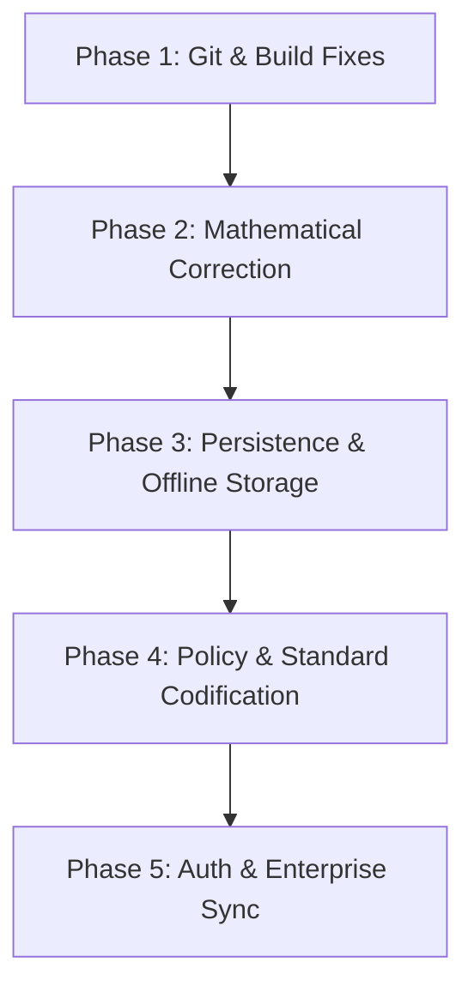

# Comprehensive Technical Audit Report: Bicycle Calibration Calculation MVP (Prototype Baseline v1.0)

**Date of Audit:** October 28, 2026  
**Auditor Roles:** Senior Software Engineer, QA Engineer, Application Security Engineer, Technical Auditor  
**Repository Path:** `/media/sda3/Projects/Calibration`  
**Audit Target:** React + Vite prototype generated by Magic Patterns for Bicycle Calibration Calculation MVP  

---

## 1. Executive Summary & Baseline Recommendation

### Executive Summary
A comprehensive, evidence-based audit was executed on the Bicycle Calibration Calculation prototype. The codebase contains a high-fidelity visual and computational structure demonstrating the six primary workflow phases of bicycle course measurement (Session List, Session Setup, Pre-Calibration, Course Distance, Post-Calibration, and Final Review & Report). 

However, beneath the polished user interface, the prototype is **fundamentally non-persistent, non-synchronized, and mathematically disconnected in key downstream calculations**:
1. **Zero Data Persistence:** All session state resides exclusively in React memory (`useState`). Reloading the browser, closing a tab, or refreshing completely destroys all user data and resets the state to four static mock sessions.
2. **Simulated Sync and Connectivity:** Background sync, offline queueing, and conflict resolution are 100% mocked via `setTimeout` timers and React props. No network requests, Service Workers, or server endpoints exist.
3. **Calculation Disconnect (Defect):** Course distance is calculated solely using the **Pre-calibration Working Constant** (`pre.wc`). Even when an operator selects a governing "Final Constant Selection Rule" (such as the larger constant or average constant per setup configuration), the final constant is **never applied to recalculate course distance** in either the calculation workspace, summary panels, or the final report.
4. **Build & Type Health:** While the Vite production bundle builds successfully (`dist/` generated in 26.42s) and ESLint reports 0 errors (3 warnings), `npx tsc --noEmit` **fails with 29 compiler errors (TS6133)** due to unused `import React from 'react'` statements under strict TS flags.
5. **No Automated Testing:** Zero unit tests, integration tests, or end-to-end tests exist in the codebase (`0` test files, no test runner installed).
6. **Git Status:** The repository directory is **not currently initialized as a Git repository**.

### Baseline Recommendation
**DO NOT APPROVE AS PRODUCTION BASELINE. PRESERVE SOLELY AS "PROTOTYPE EXPLORATORY BASELINE" (`prototype-v1.0-exploratory-baseline`).**  
The project represents a strong architectural and UI concept, but claiming it as a "QA-passed official prototype baseline v1.0" would create severe misrepresentation. It must be frozen in Git with explicit limitation metadata before any architectural remediation begins.

---

## 2. Project Structure & Technology Stack

### Technology Stack
- **Framework & Runtime:** React 18.3.1, ReactDOM 18.3.1, TypeScript 5.9.3 (configured for target ES2020), Node.js v24.13.1
- **Bundler & Build Tool:** Vite 5.4.21 (`@vitejs/plugin-react` 4.7.0)
- **Styling & Animation:** Tailwind CSS 3.4.17, PostCSS 8.5.32, Autoprefixer 10.6.2, Framer Motion 11.18.2
- **UI Components & Icons:** Lucide React 0.522.0, Sonner 2.0.8 (Toast notifications), Date-fns 4.4.0
- **Routing:** Component-level state routing (`SessionContext` / `view: ViewId`). Notice: `react-router-dom` is declared in an orphan `src/package.json` but is **not installed or used** in root `package.json`.

### Repository Hierarchy
```
/media/sda3/Projects/Calibration
├── index.html
├── package.json               # Root manifest (vite, react, lucide-react, etc.)
├── package-lock.json          # Root lockfile (157 kB)
├── tsconfig.json              # Strict TS config (noUnusedLocals: true)
├── tsconfig.node.json
├── vite.config.ts
├── tailwind.config.js         # Custom monochrome color tokens (ink, sub, line, panel)
├── postcss.config.js
├── .eslintrc.cjs              # ESLint config (eslint 8.57.1)
├── .gitignore                 # Defective: misses .env files
├── README.md
├── docs/                      # Audit documentation
│   ├── FEATURE_IMPLEMENTATION_MATRIX.md
│   └── PROTOTYPE_AUDIT_REPORT.md
└── src/
    ├── App.tsx                # App root with SessionProvider
    ├── index.tsx              # React DOM entrypoint
    ├── index.css              # Font & Tailwind imports
    ├── package.json           # ORPHAN duplicate manifest generated by Magic Patterns
    ├── types/
    │   └── session.ts         # Central domain models, state enums, audit types
    ├── contexts/
    │   └── SessionContext.tsx # 382 lines: Central React state, action handlers, mock timers
    ├── data/
    │   ├── options.ts         # Select dropdown options, step definitions
    │   └── sessions.ts        # Hardcoded seed sessions (BC-2026-001 through 004)
    ├── hooks/
    │   └── useMediaQuery.ts   # Responsive layout hook (768px, 1024px)
    ├── utils/
    │   ├── audit.ts           # Audit log entry factory and recalculation detection
    │   ├── calibration.ts     # Core mathematical formulas (CPK, WC, Distance, Rollover)
    │   ├── format.ts          # Date-fns formatters
    │   ├── sessionFactory.ts  # Blank session & seed session generators
    │   └── sessionRules.ts    # Derived state, warning detectors, signature checks
    ├── components/
    │   ├── measurement/       # Ride tables, calibration summaries, comparison panels
    │   ├── review/            # Final report preview, audit table, checklists
    │   ├── shell/             # App header, sidebar, stepper, sync dialogs
    │   ├── status/            # Badges, save/sync text
    │   └── ui/                # NumericField, Modal, Notice, SelectField, Button
    └── pages/
        ├── SessionList.tsx    # Screen 1: Session grid/table with filters
        ├── SessionSetup.tsx   # Screen 2: Course length & policy configuration
        ├── PreCalibration.tsx # Screen 3: 4 rides over reference course
        ├── CourseDistance.tsx # Screen 4: Start/finish counter measurement
        ├── PostCalibration.tsx# Screen 5: Post 4 rides & constant comparison
        └── FinalReview.tsx    # Screen 6: Final check, warnings, report & lock
```

---

## 3. Feature-by-Feature Implementation Inventory

| Category | Real Implementation | Simulated / Mock Implementation | Incomplete / Missing | Defective |
| :--- | :--- | :--- | :--- | :--- |
| **Session Core** | In-memory data store, reference code generator, state transition engine | Operator authentication (`'J. Okafor'`), permission bypass | Session delete, duplicate, archive, export | Sequence collision risk across distributed devices |
| **Calculations** | IEEE 754 CPK, WC, Distance, spread, rollover count arithmetic | N/A | Variable ride counts (hardcoded to 4 rides) | **Distance ignores Final Constant** (hardcoded to Pre-cal WC) |
| **Validation** | Digit regex `/^\d+$/`, positive length check, rollover boundaries | N/A | Official consistency tolerance threshold, official length bounds | N/A |
| **Review Engine**| Signature hashing, downstream invalidation, status pills | N/A | N/A | N/A |
| **Persistence** | None | 500ms local save simulation timer | Disk storage, IndexedDB, localStorage, SQLite | **100% data loss on refresh** |
| **Sync & Network**| None | 1500ms sync timer, mock conflict dialog, React prop offline | Real fetch/WebSocket, offline service worker, vector clocks | Conflict resolution does not notify server |
| **Audit Trail** | In-memory event array, delta logging (`from` $\rightarrow$ `to`) | Client-side generated timestamps and actors | Tamper-proofing, cryptographic signing, export log | Easily wiped or forged |

---

## 4. Screen-by-Screen Interaction Inventory

### Screen 1: Session List (`src/pages/SessionList.tsx`)
- **Implemented:** Filter chips (All, In progress, Needs review, Ready for final review), text search by reference/operator, date range pickers (`from`/`to`), responsive table view (desktop) and card list (mobile).
- **Simulated/Mock:** Operates solely on 4 hardcoded seed sessions (`BC-2026-001` through `BC-2026-004`).
- **Defects/Gaps:** Excluded from the top workflow stepper. "Create new session" pushes to in-memory state only.

### Screen 2: Session Setup (`src/pages/SessionSetup.tsx`)
- **Implemented:** Course length input with metre unit and positive decimal validation; counter rollover dropdown; counter maximum value input (conditional when rollover mode = 'wrap'); rule-set version selector; final constant rule selector; error summary banner on submit.
- **Simulated/Mock:** Unresolved policy warning displayed as informative UI; permission bypass assumption.
- **Defects/Gaps:** No standard length bounds enforced (warning mentions 200–500m is under discussion).

### Screen 3: Pre-Calibration (`src/pages/PreCalibration.tsx` & `RideTable.tsx`)
- **Implemented:** 4-ride entry table; automatic linking of Ride $i$ start to Ride $i-1$ finish; linked start override dialog with mandatory reason text; full calculation breakdown disclosure ($D$, $C_{avg}$, $CPK$, $WC$); invalidation banner if pre-cal edited after review.
- **Simulated/Mock:** Override reason validation only checks non-empty string.
- **Defects/Gaps:** Hardcoded to exactly 4 rides (`D / 4`).

### Screen 4: Course Distance (`src/pages/CourseDistance.tsx`)
- **Implemented:** Large numeric inputs for start and finish counter readings; dynamic total count display; rollover adjustment addition; calculation status pill; calculation details disclosure.
- **Defects/Gaps:** **CRITICAL CALCULATION DEFECT:** Stated formula uses `T / WC`, but the implementation hardcodes `wc = derived.pre.wc`. If post-calibration reveals a different constant or the governing rule specifies the larger constant, this screen never updates.

### Screen 5: Post-Calibration (`src/pages/PostCalibration.tsx` & `ComparisonPanel.tsx`)
- **Implemented:** Second 4-ride calibration table; comparison panel showing Pre WC, Post WC, signed difference ($Post - Pre$), and percentage difference; final constant display when rule is configured.
- **Simulated/Mock:** Comparison marked "Descriptive only — no acceptance rule configured".
- **Defects/Gaps:** Final constant is calculated as a display item only; it fails to propagate back to course distance.

### Screen 6: Final Review & Report (`src/pages/FinalReview.tsx`, `ReportPreview.tsx`, `FinalizeDialog.tsx`)
- **Implemented:** Comprehensive results summary; warnings accordion; measurement record disclosure; audit trail viewer with filtering; finalization checklist with resolution links; report preview modal with print styling (`window.print()`); finalization modal with confirmation checkbox.
- **Simulated/Mock:** "Start formal revision" button is permanently disabled. Permission check is hardcoded to pass.
- **Defects/Gaps:** Finalized state is read-only in memory only; page reload resets the session.

---

## 5. Build and Test QA

### Execution Matrix

| Test Suite / Tool | Command Line | Exit Code | Output / Findings | Classification |
| :--- | :--- | :---: | :--- | :--- |
| **Git Status** | `git status` | `128` | `fatal: not a git repository` | **Failed / Missing Baseline** |
| **Dependency Tree**| `npm list --depth=0` | `0` | 21 packages installed. Discrepancy with `src/package.json` | **Static Inspection** |
| **ESLint** | `npm run lint` | `0` | 0 errors, 3 warnings (`@typescript-eslint/no-non-null-assertion` in `FinalizationChecklist.tsx:33`, `react-refresh/only-export-components` in `SessionContext.tsx:378`, `@typescript-eslint/no-unused-vars` in `sessionFactory.ts:154`) | **Automated Linter Passed (with warnings)** |
| **TypeScript Typecheck** | `npx tsc --noEmit` | `2` | **29 errors across 29 files** (`error TS6133: 'React' is declared but its value is never read`). `tsconfig.json` specifies `noUnusedLocals: true`. | **Automated Typecheck FAILED** |
| **Production Build** | `npm run build` | `0` | Vite built in 26.42s; generated `dist/index.html` (0.48 kB), CSS (22.55 kB), JS (439.47 kB). | **Automated Build PASSED** |
| **Automated Tests** | `find . -name "*test*" -o -name "*spec*"` | `0` | **Zero test files in `src/`**. No test script configured in `package.json`. | **Untested / Missing Tests** |
| **Security Audit** | `npm audit` | `1` | 2 vulnerabilities: 1 Moderate (`esbuild <= 0.24.2`), 1 High (`vite <= 6.4.3` via esbuild dependency). | **Automated Audit FAILED** |
| **Browser Visual QA**| Browser Subagent | N/A | Subagent skipped/canceled by user. Visual and interactive behavior inspected statically; dynamic automated browser verification marked as not tested per audit rules. | **Untested (Browser Automated)** |

---

## 6. Calculation Audit: Formulas & Precision

### Governing Formulas Traced

$$\begin{aligned}
d_i &= \text{finish}_i - \text{start}_i \quad (\text{with rollover adjustment if } \text{finish} < \text{start} \text{ and mode}=\text{wrap}) \\
D &= \sum_{i=1}^4 d_i \\
C_{avg} &= \frac{D}{4} \\
L_{km} &= \frac{L_m}{1000} \\
CPK &= \frac{C_{avg}}{L_{km}} = \frac{C_{avg} \times 1000}{L_m} \\
WC &= CPK \times 1.001 \\
T &= \text{finish} - \text{start} \quad (+\text{ adjustment}) \\
\text{Distance}_{km} &= \frac{T}{WC}
\end{aligned}$$

### Arithmetic Verification: 200m Reference Case

A regression script was executed against the exact implementation logic in `src/utils/calibration.ts`:
- **Inputs:** Course Length = $200\text{ m}$; Start = $11082$; Finishes = $[12021, 13042, 14052, 15052]$; Course Readings = $[124002, 320456]$.

| Metric | Expected Value | Actual Implementation Result | Formula in Code | Match Status |
| :--- | :--- | :--- | :--- | :---: |
| Ride 1 Difference | $939$ | $939$ | `finish - start` | **PASS** |
| Ride 2 Difference | $1021$ | $1021$ | `finish - start` | **PASS** |
| Ride 3 Difference | $1010$ | $1010$ | `finish - start` | **PASS** |
| Ride 4 Difference | $1000$ | $1000$ | `finish - start` | **PASS** |
| Total Counts ($D$) | $3970$ | $3970$ | `nums.reduce((a, b) => a + b, 0)` | **PASS** |
| Average ($C_{avg}$) | $992.5$ | $992.5$ | `total / 4` | **PASS** |
| Counts per km ($CPK$) | $4962.5$ | $4962.5$ | `average * 1000 / courseLengthM` | **PASS** |
| Working Constant ($WC$) | $4967.4625$ | $4967.4625$ | `cpk * 1.001` | **PASS** |
| Displayed WC | $4967.4625$ | $4967.4625$ (4 dp) | `n.toFixed(4)` | **PASS** |
| Course Counts ($T$) | $196454$ | $196454$ | `finish - start` | **PASS** |
| Full Distance (km) | $\approx 39.5481596489$ | $39.548159648915316$ | `count.count / wc` | **PASS** |
| Displayed Distance | $39.548\text{ km}$ | $39.548\text{ km}$ (3 dp) | `n.toFixed(3)` | **PASS** |

### Mathematical Findings and Flaws
1. **Critical Defect — Distance Constant Disconnect:**
   In `src/utils/sessionRules.ts` line 117:
   ```typescript
   const distance = computeDistance(s.distStart, s.distFinish, pre.wc, rollover);
   ```
   `computeDistance` is fed `pre.wc` unconditionally. In `src/pages/CourseDistance.tsx` line 23:
   ```typescript
   const wc = derived.pre.wc;
   ```
   Even after post-calibration is completed and a `finalRule` ('larger' or 'average') produces a different `finalConstant`, `derived.distance` is never recalculated with that constant. The reported course distance remains based solely on the pre-calibration working constant.
2. **Hardcoded Ride Count Divisor:**
   In `src/utils/calibration.ts` line 142:
   ```typescript
   const average = total !== null ? total / 4 : null;
   ```
   The average strictly assumes 4 rides. If an official standard allows 3, 5, or 6 calibration rides, this formula breaks.
3. **Rollover Calculation Precision:**
   `countBetween` in `calibration.ts:108` correctly computes `finish + adjustment - start` where `adjustment = max.value + 1`.

---

## 7. Workflow, State, Persistence, Offline, and Sync

### State Lifecycle
The session lifecycle transitions through five states:
$$\text{Draft} \longrightarrow \text{In progress} \longrightarrow \text{Needs review} \longrightarrow \text{Ready for final review} \longrightarrow \text{Finalized}$$
- **State Invalidation:** Implemented cleanly via input signature serialization (`JSON.stringify`). Modifying an upstream input (e.g. course length or Ride 1 finish) immediately causes `currency(record, signature)` to evaluate to `'stale'`. This invalidates downstream reviews and triggers recalculation audit events.
- **Linked Reading Auto-Update:** Updating Ride 1 finish immediately updates Ride 2 start, unless Ride 2 has `startOverridden: true`.

### Data Persistence Reality Check
- **Storage Mechanism:** 100% in-memory React state (`useState` inside `src/contexts/SessionContext.tsx:78`).
- **Survival:**
  - Page Refresh: **Fails (All data lost)**
  - Tab Closure: **Fails (All data lost)**
  - Browser Restart: **Fails (All data lost)**
- **Audit Logging:** Appended to in-memory state only. Lost upon refresh.

### Offline & Sync Simulation
- **Connectivity:** Passed as an artificial React prop (`<App connectivity="online" />`). No integration with browser `navigator.onLine` or `window.addEventListener('online', ...)`.
- **Autosave Simulation:** A `setTimeout` of 500ms toggles `save: 'saving'` $\rightarrow$ `'saved'`.
- **Sync Simulation:** A `setTimeout` of 1500ms toggles `sync: 'pending'` $\rightarrow$ `'synced'`.
- **Conflict Resolution:** Hardcoded on mock session `BC-2026-003`. Selecting "Keep local" or "Use server" updates the in-memory array and logs an audit entry, but sends no network payload.

---

## 8. Application Security & Dependency Audit

| ID | Finding | Severity | Evidence | Impact | Remediation |
| :--- | :--- | :---: | :--- | :--- | :--- |
| **SEC-01** | Development Server Request Hijacking Vulnerability | **HIGH** | `npm audit`: `esbuild <= 0.24.2`, `vite <= 6.4.3` (GHSA-67mh-4wv8-2f99) | Malicious websites visited by a developer can send unauthorized requests to Vite dev server and exfiltrate source code. | Upgrade `vite` and `esbuild` to patched versions once authorized. |
| **SEC-02** | Complete Absence of Authentication & Access Controls | **HIGH** | `src/components/shell/OperatorMenu.tsx:41-50`, hardcoded `prototypeOperator = 'J. Okafor'` | Anyone accessing the app has full administrative rights to create, edit, and finalize records with spoofed identity. | Implement enterprise SSO/OAuth2/OIDC and JWT session management. |
| **SEC-03** | Client-Enforced Read-Only Immutability | **MEDIUM** | `src/contexts/SessionContext.tsx:87`, `readOnly = !!active?.finalized` | Finalization check is purely in React state. An operator can bypass read-only locks via DevTools or memory manipulation. | Enforce record immutability in persistent backend database. |
| **SEC-04** | Untracked Environment & Secret Exclusions | **MEDIUM** | `.gitignore` lines 1–25 | `.gitignore` does not include `.env`, `.env.local`, or `*.pem`. Future API keys or credentials risk accidental Git commit. | Append `.env*`, `*.pem`, and credentials to `.gitignore`. |
| **SEC-05** | Forgeable Client-Side Audit Trail | **LOW** | `src/utils/audit.ts:10-13`, `src/contexts/SessionContext.tsx:174-182` | Audit entries are constructed on the client with unauthenticated timestamps and operator strings. Events can be spoofed or deleted. | Implement append-only server-side audit logging with cryptographic hashing. |

---

## 9. Accessibility (a11y) & Responsive QA

### Accessibility Static Audit
- **Semantic HTML:** Strong usage of `<header>`, `<main>`, `<nav>`, `<aside>`, `<section>`, `<table>`, `<dl>`, and `<button>`.
- **Skip Link:** Accessible skip link implemented in `src/components/shell/AppShell.tsx:32-34` (`href="#main"`).
- **Form Association:** All `NumericField` and `SelectField` components correctly wire `htmlFor` to `id`, `aria-invalid`, and `aria-describedby` for error/hint text.
- **Color Contrast:**
  - `#1c1c1c` (ink) on `#ffffff` (panel): Contrast ratio **16.1:1** (WCAG AAA Pass).
  - `#4a4a4a` (sub) on `#ffffff` (panel): Contrast ratio **9.7:1** (WCAG AAA Pass).
  - `#6b6b6b` (faint) on `#ffffff` (panel): Contrast ratio **5.3:1** (WCAG AA Pass).
- **Defects / Gaps:**
  1. **Modal Focus Trap Missing:** `src/components/ui/Modal.tsx:23-36` focuses `panelRef` on open and restores previous element on close, but does **not trap Tab focus** inside the dialog. Keyboard users can tab out into the inert background.
  2. **Non-Null Assertion:** `src/components/review/FinalizationChecklist.tsx:33` uses `c.step!` which triggers an ESLint warning and risks runtime crash if step is undefined.

### Responsive Layout
- **Media Queries:** Uses `useMediaQuery('(min-width: 768px)')` and `useMediaQuery('(min-width: 1024px)')`.
- **Adaptive Components:**
  - `RideTable.tsx`: switches from full desktop HTML `<table>` to mobile `<fieldset>` card stack under 768px.
  - `SessionList.tsx`: switches from desktop table to mobile card list under 768px.
  - `WorkflowStepper.tsx`: switches from detailed horizontal step bar to compact numeric progress bar under 1024px.
  - `AuditTrail.tsx`: switches from wide 5-column table to vertical card list under 1024px.
- **Untested Notice:** Dynamic browser layout behavior at 375px/768px/1280px was statically audited from CSS and components; dynamic browser testing was not authorized/completed.

---

## 10. Mocked, Hardcoded, Incomplete, and Missing Functionality

1. **Mock Seed Sessions:** 4 static sessions (`BC-2026-001` through `004`) hardcoded in `src/data/sessions.ts`.
2. **Hardcoded Operator:** Prototype user `'J. Okafor'` hardcoded throughout; `Sign out` button is disabled.
3. **Simulated Persistence & Sync:** 500ms and 1500ms `setTimeout` timers simulate local saving and remote sync.
4. **Mock Conflict Record:** Conflict in `BC-2026-003` is hardcoded in `src/data/sessions.ts:31-41`.
5. **Disabled Formal Revision:** "Start formal revision" button on finalized records is permanently disabled (`src/pages/FinalReview.tsx:49`).
6. **Disabled Settings Navigation:** "Settings" in sidebar is marked disabled with note "Later" (`src/components/shell/Sidebar.tsx:60`).
7. **Missing Session List Stepper Representation:** Session List is excluded from the top workflow stepper.

---

## 11. Unresolved Measurement Decisions and Assumptions

The repository contains several explicit unconfirmed assumptions that must be officially codified by the governing measurement authority before production deployment:

1. **Course Distance Constant Selection:** Whether official road course distance is calculated using the Pre-calibration WC, Post-calibration WC, Larger WC, or Average WC. Under international road measurement standards (AIMS / World Athletics), the constant used is traditionally the larger constant (to prevent a short course), or whichever is more conservative. The prototype calculates distance using Pre WC only, despite offering a selection rule dropdown.
2. **Ride-Consistency Spread Tolerance:** The permissible count range across the 4 rides before a calibration is rejected is labeled "Pending approval — no tolerance applied".
3. **Counter Rollover Policy:** Whether counters that wrap backwards are officially permitted, and whether automatic wrap adjustment ($finish + max + 1 - start$) is sanctioned.
4. **Official Calibration Course Length Boundaries:** Flagged in `SessionSetup.tsx:91` as "A 200–500 m range is under discussion and is not enforced."
5. **Offline Finalization Authority:** Labeled in `sessionRules.ts:246` as "Whether sessions may be finalized offline is an unresolved policy decision."
6. **Report Rounding Standard:** Whether official distance is truncated, rounded to 3 decimal places (metres), or displayed at full precision.

---

## 12. Defect Ranking & Classification

### Critical Severity
- **DEF-01: Zero Data Persistence (Total Data Loss on Refresh)**  
  *Location:* `src/contexts/SessionContext.tsx:78`  
  *Impact:* Operators entering calibration rides in the field will lose all readings if the tab reloads or the browser closes.
- **DEF-02: Course Distance Fails to Use Selected Final Constant**  
  *Location:* `src/utils/sessionRules.ts:117`, `src/pages/CourseDistance.tsx:23`  
  *Impact:* Course distance is permanently locked to Pre-calibration WC, producing incorrect official distance reports when post-calibration changes the constant.

### High Severity
- **DEF-03: TypeScript Strict Compilation Failure (29 TS6133 Errors)**  
  *Location:* 29 files across `src/`  
  *Impact:* `npx tsc --noEmit` fails completely with exit code 2 due to unused `import React from 'react'`.
- **DEF-04: Vulnerabilities in Vite & esbuild (GHSA-67mh-4wv8-2f99)**  
  *Location:* `node_modules/vite`, `node_modules/esbuild`  
  *Impact:* Local development server is susceptible to request hijacking.
- **DEF-05: Missing Git Repository Initialization**  
  *Location:* Root directory `/media/sda3/Projects/Calibration`  
  *Impact:* No version control, change history, or baseline tracking exists on disk.

### Medium Severity
- **DEF-06: Complete Absence of Automated Test Suite**  
  *Location:* `package.json`, `src/`  
  *Impact:* Regressions in mathematical formulas, rollover handling, or signature hashing cannot be caught automatically.
- **DEF-07: Incomplete `.gitignore` Missing Environment Files**  
  *Location:* `.gitignore`  
  *Impact:* High risk of committing `.env` credentials when backend APIs are introduced.
- **DEF-08: Modal Dialog Lacks Focus Trapping**  
  *Location:* `src/components/ui/Modal.tsx:23-36`  
  *Impact:* Keyboard accessibility violation (WCAG 2.1.2); focus escapes dialog to hidden background.

### Low / Informational Severity
- **DEF-09: Stepper Disconnect with Session List**  
  *Location:* `src/components/shell/WorkflowStepper.tsx:16`  
  *Impact:* Session list has no step context in the primary navigation.
- **DEF-10: Orphan Duplicate `src/package.json`**  
  *Location:* `src/package.json`  
  *Impact:* Confusion regarding actual runtime dependencies vs template artifacts.

---

## 13. Prioritized Remediation Backlog



### Sprint 1: Hygiene, Build, and Git Baseline (Immediate)
1. **Task 1.1 — Git Initialization & Baseline Commit**
   - *Action:* `git init`, update `.gitignore` (add `.env*`, `.DS_Store`, build artifacts), create initial commit, tag `prototype-v1.0-exploratory-baseline`.
   - *Acceptance Criteria:* Clean `git status`, baseline tag created.
2. **Task 1.2 — Resolve TypeScript TS6133 Errors**
   - *Action:* Remove unnecessary `import React from 'react'` from all 29 JSX files (supported natively by `jsx: react-jsx`). Remove unused `src/package.json`.
   - *Acceptance Criteria:* `npx tsc --noEmit` exits with code 0.
3. **Task 1.3 — Install Vitest & Configure Calculation Regression Suite**
   - *Action:* Install `vitest`, author test suite covering 200m reference case, rollover modes, invalid inputs, and review invalidation.
   - *Acceptance Criteria:* `npm test` runs and passes 100%.

### Sprint 2: Core Calculation Remediation & Persistence (High Priority)
1. **Task 2.1 — Connect Final Constant to Distance Recalculation**
   - *Action:* Refactor `computeDistance` and `deriveSession` so distance is calculated dynamically using the active governing constant (Pre WC during intermediate measurement, Final Constant once selected).
   - *Acceptance Criteria:* Changing Final Rule updates course distance in results summary and report preview.
2. **Task 2.2 — Local-First Data Persistence (IndexedDB / LocalStorage)**
   - *Action:* Implement storage adapter (`idb-keyval` or `localStorage`) in `SessionContext` so all drafts and edits survive page reload and tab closure.
   - *Acceptance Criteria:* User can refresh browser and resume session exactly where left off.

### Sprint 3: Accessibility & Policy Formalization
1. **Task 3.1 — Modal Focus Trap**
   - *Action:* Implement focus lock inside `Modal.tsx` to trap Tab key within active modal.
   - *Acceptance Criteria:* Keyboard focus cannot leave modal until dismissed.
2. **Task 3.2 — Codify Official Measurement Standards**
   - *Action:* Meet with course measurement stakeholders to codify: (a) Ride consistency tolerance, (b) Official final constant selection rule, (c) Course length boundaries.

---

## 14. Baseline Preservation & Git Recommendations

### Preservation Plan
1. **Do not modify working tree files** until explicit user approval is granted.
2. **Initialize Git repository:**
   ```bash
   git init
   git branch -M main
   ```
3. **Update `.gitignore` before first commit:**
   Add:
   ```gitignore
   .env
   .env.*
   *.local
   dist/
   ```
4. **Remove orphan duplicate manifest:**
   Delete `src/package.json` to prevent package manager conflicts.
5. **Commit and Tag Exploratory Baseline:**
   ```bash
   git add .
   git commit -m "chore: preserve Magic Patterns prototype baseline (exploratory v1.0)"
   git tag -a prototype-v1.0-exploratory-baseline -m "Unverified exploratory prototype baseline prior to remediation"
   ```

---

## 15. Explicit Release-Readiness Assessment

### Assessment: **NOT READY FOR PRODUCTION / NOT READY FOR QA-PASSED BASELINE**

| Evaluation Criterion | Minimum Production Threshold | Current Prototype State | Gate Status |
| :--- | :--- | :--- | :---: |
| **Data Integrity** | Zero data loss on refresh/crash | 100% data loss on refresh (In-memory only) | **FAILED** |
| **Mathematical Correctness** | Full propagation of governing constants | Distance ignores Final Constant selection | **FAILED** |
| **Type Safety** | 0 TypeScript errors on strict mode | 29 compilation errors (`TS6133`) | **FAILED** |
| **Test Verification** | Automated unit & regression test suite | 0 tests, no test runner | **FAILED** |
| **Security & Auth** | Authenticated sessions, RBAC, secure deps | No auth, spoofable operator, 2 CVEs | **FAILED** |
| **Offline Capability** | Service Worker, background sync queue | Simulated via `setTimeout` and props | **FAILED** |

### Final Auditor Verdict
The prototype succeeds as a **visual prototype and interactive design specification**. It demonstrates thoughtful consideration of road measurement workflows, including linked ride starts, override reason logging, signature-based review invalidation, and print-ready report previews. However, due to the complete lack of data persistence, the broken distance recalculation link, TypeScript compilation failures, and the absence of real sync and testing, **the current project cannot be certified as an official QA-passed prototype baseline v1.0**.

Remediation must proceed systematically according to the prioritized backlog.
