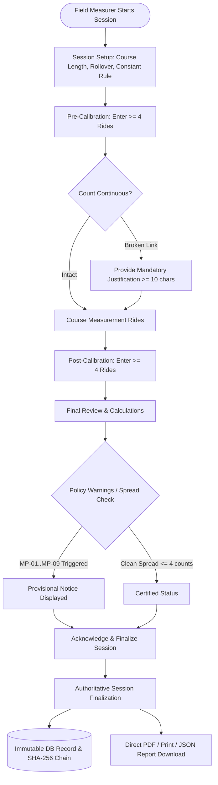

# Bicycle Calibration Platform: User Roles & Autonomous Operational Workflow

**Document Version:** 1.0.0  
**Status:** Approved & Implemented  
**Target Systems:** Frontend (Vite/React/Tailwind) & Backend (FastAPI/SQLAlchemy/PostgreSQL 16)

---

## 1. Executive Philosophy & Architectural Intent

The Bicycle Calibration Platform is engineered to **empower individual Field Measurers to autonomously and accurately execute their jobs in the field**. 

Unlike bureaucratic review systems where field operators must wait for multi-tier administrative approvals before obtaining a certified calculation, this system provides:
1. **Instantaneous Authoritative Calculation:** Calculations are evaluated with deterministic pure Python `Decimal` arithmetic.
2. **Provisional Policy Guardrails:** Non-blocking warnings (e.g., MP-01 through MP-09) guide measurers on ride spread, temperature deltas, and count discrepancies without locking down their progress.
3. **Direct Report Generation:** Upon finalization, the field measurer immediately receives their authoritative calibration report in PDF, printable view, or structured JSON.
4. **Administrative Observability without Bottlenecks:** Administrators monitor aggregate platform health and volume without intervening in individual measurement sessions.

---

## 2. Role Taxonomy & Responsibility Matrix

The system defines three primary operational roles:

```
+-----------------------------------------------------------------------------------+
|                                  USER ROLES                                       |
+--------------------------+----------------------------+---------------------------+
|   User (Field Measurer)  |   Admin (Overview Monitor) | System Admin (SecOps/IT)  |
+--------------------------+----------------------------+---------------------------+
| Autonomous Field Worker  | Program Observer           | Platform Administrator    |
| • Session Setup          | • Total Users Count        | • OIDC / Identity Mgt     |
| • Raw Count Entry        | • Total Sessions Count     | • RBAC Role Assignments   |
| • Continuous Overrides   | • Finalized Reports Volume | • DB Schema Migrations    |
| • Review Spread Warnings | • Active Drafts Metric     | • SHA-256 Audit Ledger    |
| • Direct PDF Download    | • Monthly Trends View      | • Container Orchestration |
+--------------------------+----------------------------+---------------------------+
```

### 2.1 Role 1: User (`measurer`) — Autonomous Field Operator
* **Primary Purpose:** Operates the bicycle with the Jones Counter on the calibration course and intermediate course routes, records raw ride count readings, handles setup, and produces completed certified measurement sessions.
* **Core Responsibilities:**
  1. **Session Setup:**
     - Creates new calibration sessions (assigned unique reference `BC-YYYY-NNN`).
     - Enters course distance in metres (e.g., 1000m, 400m).
     - Selects rollover mode (`none` or `wrap` with configurable counter digits, e.g. 100,000 counts).
     - Chooses constant selection rule (`larger` for World Athletics standard safety margin vs. `average`).
  2. **Data Entry & Ride Execution:**
     - Enters start and finish counts for **Pre-Calibration** ($\ge 4$ valid rides required).
     - Enters intermediate **Course Measurement** rides.
     - Enters start and finish counts for **Post-Calibration** ($\ge 4$ valid rides required).
  3. **Continuous Count Linking & Overrides:**
     - The system automatically links the start count of Ride $N+1$ to the finish count of Ride $N$.
     - If the bicycle was moved or the counter spun between rides, the measurer can override the linked start count by supplying a **mandatory operational justification** ($\ge 10$ characters).
  4. **Review & Policy Warning Analysis:**
     - Reviews ride spread metrics (flags spread $> 4$ counts for pre/post-cal or $> 8$ counts overall).
     - Reviews provisional notices (MP-01 through MP-09) and temperature compensation flags.
  5. **Finalization & Report Generation:**
     - Runs the finalization checklist (pre-cal $\ge 4$, course measured, post-cal $\ge 4$).
     - Finalizes session: locks session immutability and generates cryptographic SHA-256 event hash.
     - **Immediately downloads the official PDF report**, prints the document, or exports JSON.
     - *No supervisory approval or administrative ticket is required to obtain the report.*

### 2.2 Role 2: Admin (`admin`) — Operational Overview Monitor
* **Primary Purpose:** Program-level observability, throughput monitoring, and high-level tracking across all measurers and regional measurement campaigns.
* **Core Responsibilities:**
  1. **Aggregate Metric Dashboard (`GET /api/v1/admin/overview`):**
     - **Total Users:** Number of registered measurers and operators on the platform.
     - **Total Sessions:** Lifetime count of created calibration sessions.
     - **Finalized Reports:** Number of successfully completed, certified reports.
     - **In-Progress Drafts:** Number of sessions currently underway in the field.
  2. **Operational Trends Analysis:**
     - 6-month historical activity trend tracking (sessions initiated vs. reports finalized).
  3. **Recent Activity Monitoring:**
     - Searchable view of recent sessions showing session reference, measurer name, course name, status (`draft`, `finalized`, `superseded`), and provisional warning flags.
  4. **Zero-Friction Stance:**
     - The Admin role **does not** act as a gatekeeper or approver. They cannot reject, alter, or delay an autonomous measurer's completed report.

### 2.3 Role 3: System Admin (`system_admin` / `supervisor`) — Security & IT Infrastructure
* **Primary Purpose:** Identity lifecycle, security enforcement, cryptographic audit compliance, and platform reliability.
* **Core Responsibilities:**
  1. **Identity & Access Management (IAM):**
     - Manages OIDC authentication providers (Keycloak / Google / Mock Auth).
     - Assigns RBAC roles and permissions (`session:create`, `session:read`, `audit:verify`, `role:manage`).
  2. **Cryptographic Audit Verification (`POST /api/v1/audit/verify-audit`):**
     - Validates the unbroken SHA-256 hash-chain across all recorded audit entries.
     - Detects unauthorized database mutations or out-of-band tampering.
  3. **Database Health & Migrations:**
     - Applies Alembic schema migrations (`alembic upgrade head`).
     - Manages automated PostgreSQL backups and disaster recovery.
  4. **System Reliability & Deployment:**
     - Oversees container execution via Docker Compose and unified runner scripts (`./run.sh dev`, `./run.sh check`).

---

## 3. End-to-End Autonomous Field Measurer Workflow



### Detailed Lifecycle Steps

1. **Step 1: Session Initialization (`SessionSetup.tsx`)**
   - Measurer launches application (online or offline with PWA IndexedDB sync).
   - Generates session reference (e.g., `BC-2026-001`).
   - Configures calibration course parameters: baseline distance (e.g. 1000.000m), optional Calibration base name (e.g., "Waterfront 1000m Reference Base"), rollover wrap threshold, and calculation rules.

2. **Step 2: Pre-Calibration Rides (`PreCalibration.tsx`)**
   - Measurer completes at least 4 rides on the calibration course.
   - For each ride: enters Start Count and Finish Count.
   - Instant calculation: Net counts, individual constant ($C = \text{counts} / \text{distance}$), and pre-calibration spread.
   - Spread warning triggers if $\text{max}(C) - \text{min}(C) > 4 \text{ counts}$.

3. **Step 3: Intermediate Course Measurement (`CourseDistance.tsx`)**
   - Measurer rides the official race/event route.
   - Enters start and finish counts for each section or overall lap.
   - Applies the working constant to calculate raw measured distance.

4. **Step 4: Post-Calibration Rides (`PostCalibration.tsx`)**
   - Measurer returns to the calibration course after the course measurement.
   - Completes at least 4 post-calibration rides.
   - Computes post-calibration working constant and verifies post-calibration spread.
   - Evaluates Day Constant based on selected rule (larger of pre/post vs. average).

5. **Step 5: Review & Safeguards (`FinalReview.tsx`)**
   - Finalization checklist validates that all data prerequisites are met:
     - Pre-calibration rides $\ge 4$
     - Intermediate course measured
     - Post-calibration rides $\ge 4$
     - All broken ride links justified
   - Evaluates Policy Warnings (MP-01 through MP-09). If conditions warrant, the report is marked `is_provisional = True` with clear explanatory reasons.

6. **Step 6: Finalization & Direct Report Download**
   - Measurer clicks **Finalize Session**.
   - Session status transitions to `finalized`. The session record becomes permanently immutable.
   - An authoritative PDF report is immediately available for download or print.
   - **No administrative wait time or approval step is required.**

7. **Step 7: Formal Session Revision (If Corrections Needed Post-Finalization)**
   - If an error in data entry is discovered after finalization, the finalized record is never mutated in-place.
   - Measurer initiates **Create Revision** (`POST /api/v1/sessions/{id}/revise`).
   - Measurer supplies a mandatory operational justification ($\ge 10$ characters).
   - The original session status transitions to `superseded` (`superseded_by_ref` points to the new session).
   - A new revision session is created in `draft` status, allowing the measurer to rectify values and finalize a new authoritative report.

---

## 4. API Endpoints for Roles & Operations

| Role | Method | Endpoint | Description |
| :--- | :--- | :--- | :--- |
| **Public / Measurer** | `POST` | `/api/v1/auth/register` | Self-register new Field Measurer account with immediate `measurer` role |
| **Public / Measurer** | `POST` | `/api/v1/auth/login` | Sign in with email and password, returning JWT access & refresh tokens |
| **Measurer** | `POST` | `/api/v1/auth/refresh` | Refresh JWT access token with valid refresh token |
| **Measurer** | `GET` | `/api/v1/auth/me` | Retrieve authenticated user profile with roles and permissions |
| **Measurer** | `POST` | `/api/v1/sessions` | Create a new calibration session |
| **Measurer** | `GET` | `/api/v1/sessions` | List sessions owned by the authenticated measurer |
| **Measurer** | `GET` | `/api/v1/sessions/{id}` | Retrieve full session data and calculation results |
| **Measurer** | `PUT` | `/api/v1/sessions/{id}` | Update draft session (guarded against finalized) |
| **Measurer** | `POST` | `/api/v1/sessions/{id}/finalize` | Finalize session and lock immutability |
| **Measurer** | `POST` | `/api/v1/sessions/{id}/revise` | Create a linked revision with mandatory reason |
| **Admin** | `GET` | `/api/v1/admin/overview` | Retrieve high-level aggregate platform metrics |
| **System Admin** | `POST` | `/api/v1/audit/verify-audit` | Verify unbroken SHA-256 cryptographic audit chain |
| **System Admin** | `GET` | `/api/v1/auth/roles` | Inspect and manage RBAC entitlements |

---

## 5. Administrative Seeding CLI

For bootstrapping the initial platform administrator or elevating accounts without raw database SQL edits, the system provides a dedicated CLI tool:

### 5.1 Interactive Account Creation
```bash
./run.sh admin:create
```
Prompts the operator securely for:
* Administrator Email Address
* Display Name (default: *Platform Administrator*)
* Organization / Affiliation (default: *Platform Administration*)
* Role (*admin*, *supervisor*, *reviewer*, *auditor*, *measurer*)
* Password (hidden input, minimum 8 characters with confirmation)

### 5.2 Non-Interactive / CI/CD Deployment Flags
```bash
./run.sh admin:create \
  --email "admin@calibration.local" \
  --password "YourSecurePassword2026!" \
  --name "Lead Administrator" \
  --role "admin" \
  --organization "World Athletics / AIMS" \
  --non-interactive
```

Supported flags:
* `--email EMAIL`: Administrator email.
* `--password PASSWORD`: Plaintext password ($\ge 8$ chars, hashed with `scrypt`).
* `--name NAME`: Full display name.
* `--role {admin,supervisor,reviewer,auditor,measurer}`: Target RBAC role.
* `--organization ORG`: Organization or federation affiliation.
* `--update`: Updates credentials and profile if the user already exists.
* `--non-interactive`: Fails immediately if required arguments are missing rather than prompting.

---

## 6. Mandatory Authentication Gate, Zero-Mock Workspace & Measurer Onboarding

### 6.1 Mandatory Auth Gate (`<AuthScreen />`)
To safeguard measurement integrity and enforce strict credential attribution:
- **No Unauthenticated Access:** Visitors are gated by `<AuthScreen />` on application launch (`/`). No session list, setup interface, calculation engine, or admin view is accessible without logging in or registering.
- **Default to "Create Measurer Account":** First-time visitors immediately see the registration form by default, with tabs to toggle to "Sign In".
- **Field-Ready Credential Fields:** Full Name, Email Address, Password ($\ge 8$ characters with show/hide toggle), and Optional Affiliation/Organization (e.g. World Athletics / AIMS / National Athletics Federation).
- **Autonomous Activation Guarantee:** Highlights that measurer accounts are active immediately without waiting for administrator review.

### 6.2 Zero Mock Data on User Dashboard
- Prototype mock sessions (`BC-2026-001..004`) are removed from standard user environments.
- Newly authenticated measurers land on a completely clean field workspace.
- In-memory/query scenario toggles (`?scenario=examples`) are preserved exclusively for automated testing and demonstrations.

### 6.3 Calm, Human Onboarding Flow
When a measurer logs in with zero active sessions, the dashboard presents a calm, human-centric empty state:
- **Personalized Header:** `"Welcome, {display_name}."`
- **Accreditation Badge:** Displaying organizational affiliation if provided.
- **Calming Prompt:** `"Would you like to start your bicycle calibration session now, or explore your workspace first?"`
- **Primary CTA:** `"Start Calibration Now"` — immediately creates `BC-2026-001` and opens the Reference Course Setup.
- **Secondary CTA:** `"Explore Workspace First"` — toggles a calm, 4-step workflow guide:
  1. *Reference Course Setup* — Steel-tape course length & temperature entry.
  2. *Pre-Calibration Rides* — 4 consecutive runs with instant constant calculation.
  3. *Course Measurement* — Raw Jones counter intervals & intermediate turns.
  4. *Post-Cal & Certified Report* — 4 post-rides, drift verification, and SHA-256 certificate generation.

### 6.4 Local-First Offline Session Persistence
- Active credentials and user profile are saved locally under `bicycle_calibration_local_tokens` and `bicycle_calibration_local_user`.
- Calibration sessions and audit events persist in IndexedDB (`bicycle_calibration_db`).
- Measurers can close their browser or operate completely offline in remote road environments without being logged out.
- Sessions automatically synchronize to PostgreSQL when an internet connection is re-established.


